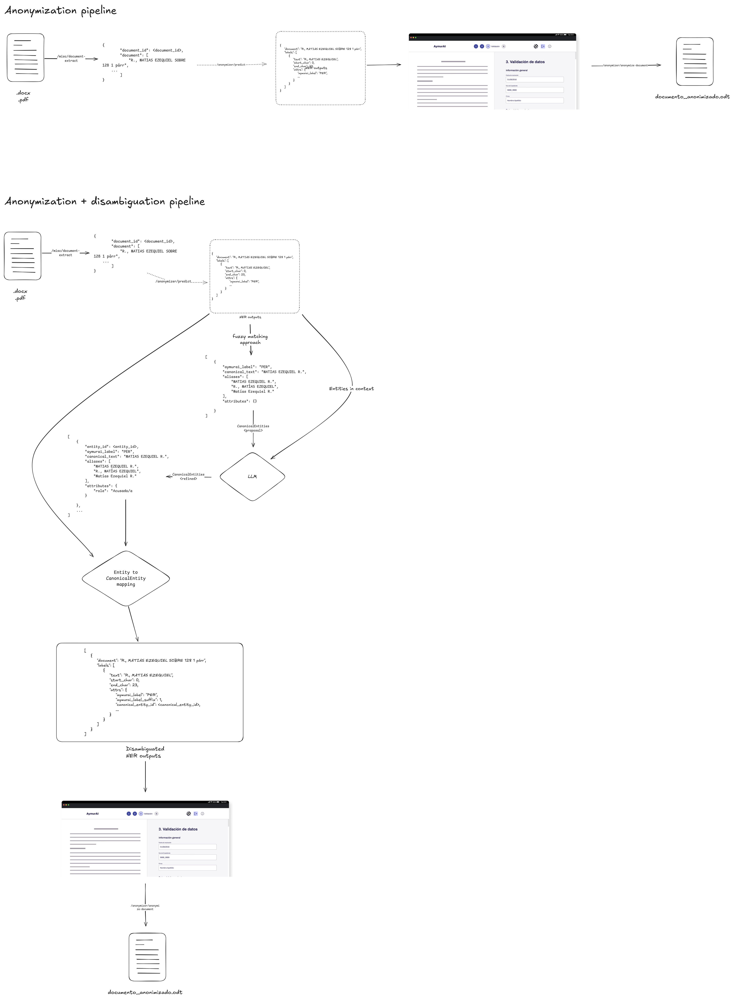

# Entity Disambiguation
Language: **English** | [Español](../es/anonymization/README.md)

Design notes and evaluation criteria for canonical entity disambiguation — the
step that decides which NER spans across a document refer to the *same* real
entity, so that anonymization replaces them consistently.

> **Read this as design material, not as a description of production.** The
> diagram below includes an LLM refinement stage that is a **proposal**; it is
> not wired into any pipeline. What ships today is the fuzzy-matching path
> described under [What is implemented](#what-is-implemented).

## Contents
- Evaluation metric for the disambiguator (Spanish): [../metrics/entity-disambiguation-metric.md](../metrics/entity-disambiguation-metric.md)
- Pipeline diagram: `pipeline.png` (editable source: [`pipeline.excalidraw`](pipeline.excalidraw))

## Proposed flow

The upper track is the shipped anonymization flow. The lower track is the
proposed extension: NER outputs are clustered by fuzzy matching into a
`CanonicalEntities` *proposal*, an LLM refines that proposal using the
surrounding context (assigning `attributes.role`, merging or splitting clusters),
and the refined set is mapped back onto the spans before rendering.

Regenerate the PNG with `node scripts/render-excalidraw.mjs` after editing the
scene.

## What is implemented
Production disambiguation is fuzzy matching only — there is no LLM in this path:

- `aymurai/utils/entity_disambiguation/fuzzy.py` clusters alias surface forms with
  a union-find over a distance matrix, picks a cluster label and the longest alias
  as `canonical_text`, and builds `CanonicalEntity` objects.
- `aymurai/utils/entity_disambiguation/core.py` assigns `aymurai_label_instance`
  numbers and maps canonical entities back onto NER predictions.
- `CanonicalEntity` (`aymurai/meta/entities.py`) carries `entity_id`,
  `aymurai_label`, `canonical_text`, `aliases` and a free-form `attributes` dict.
  When `entity_id` is absent it is derived as a UUID5 over the other fields.
- The match threshold is `THRESHOLD` (default `70`); per-label behaviour comes
  from `DISAMBIGUATION_LABEL_POLICIES`. See the
  [configuration reference](../configuration/README.md#anonymization).

`attributes.role` appears throughout the design diagram and the metric document,
but nothing in the current pipeline populates it.

## Why a dedicated metric
The disambiguator is evaluated separately from the NER model, which is scored
with per-class F1. Getting the spans right and getting the *clustering* right are
different problems: a perfect NER with a bad disambiguator still leaks identity
across a document, because the same person receives inconsistent replacements.

The proposed metric combines four components — canonical entity detection,
alias grouping quality, label accuracy and role accuracy — into a single weighted
score. See [the metric document](../metrics/entity-disambiguation-metric.md).

## Related docs
- Anonymizer flow: [../pipelines/anonymizer/README.md](../pipelines/anonymizer/README.md)
- Anonymizer entities: [../entities/anonymizer/README.md](../entities/anonymizer/README.md)
- API reference: [../api/README.md](../api/README.md)
- Configuration: [../configuration/README.md](../configuration/README.md)
