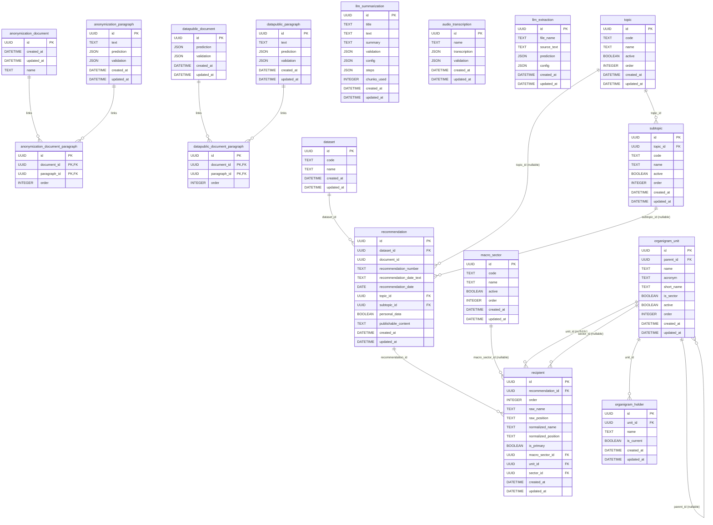

# Internal Database
Language: **English** | [Español](../es/database/README.md)

This document describes the internal persistence used by the API runtime.

## Engine and Migrations
- ORM: `SQLModel` (`sqlalchemy` backend)
- Migration tool: Alembic
- Runtime setting: `SQLALCHEMY_DATABASE_URI`
- Default DB URI: `sqlite:////resources/cache/sqlite/database.db`
- Startup behavior:
  1. API checks DB connectivity.
  2. If SQLite file does not exist, it creates parent directories.
  3. API runs `alembic upgrade head` on startup.

Related code:
- `aymurai/settings.py`
- `aymurai/api/startup/database.py`
- `aymurai/api/main.py`
- `aymurai/database/versions/13f78d08e925_create_database.py` (base schema)
- `aymurai/database/versions/49b3f24f7ad0_add_audio_transcription_table.py`
- `aymurai/database/versions/8f2c6a10b7d3_add_llm_summarization_table.py`
- `aymurai/database/versions/dd89f40c7c3e_add_catalogs_tables.py`
- `aymurai/database/versions/ddf5877c18e3_add_organigram_tables.py`
- `aymurai/database/versions/fb3a0fa1490d_add_llm_extraction_table.py`
- `aymurai/database/versions/bd2987fdfc0e_add_dataset_recommendation_recipient_tables.py` (head)

The last four are the Defensoría del Pueblo (CABA) feature (see
[below](#defensoría-del-pueblo-caba)) and apply in that order — `catalogs` and
`organigram` first, since `recipient`/`recommendation` have foreign keys into
them. **These migrations always run**, independent of the `DEFENSORIA_ENABLED`
feature flag, which only gates whether the corresponding routers are mounted.

## Operations

### Location and volume persistence
Inside the container the database lives at
`/resources/cache/sqlite/database.db`; on the host it's
`./resources/cache/sqlite/database.db`, reachable via the
`./resources/cache:/resources/cache` bind mount on every API variant
(`aymurai-api`, `aymurai-api-gpu`, `aymurai-api-full`, `aymurai-api-full-gpu`).
That mount has to stay a bind mount tied to the host, not to the container:
if the database only lived in the container's writable layer, recreating the
container (redeploy, `--force-recreate`, an image update) would silently
wipe it. This was a real bug on the `api-full` profile, fixed as part of this
Fase — the profile's compose definition was missing the mount entirely.

### Automatic backups
The `db-backup` sidecar (`docker/backup/backup.py`) runs in a loop, using
`sqlite3.Connection.backup()` — safe under WAL, unlike copying the file with
`cp`, which can capture it mid-checkpoint — and writes dated snapshots
`database_<timestamp>.db` to `./resources/backups` (mounted at `/backups`
in the container). Configuration, with the defaults shipped in
`docker-compose.yml`:
- `BACKUP_SOURCE_DB` — default `/resources/cache/sqlite/database.db`
- `BACKUP_INTERVAL_SECONDS` — default `3600` (one backup per hour)
- `BACKUP_RETENTION` — default `30`; keeps the newest N dated backups and
  deletes older ones. `BACKUP_RETENTION <= 0` disables pruning — it does
  **not** mean "delete everything."

For a manual, immediate backup outside the interval: `make db-backup`, which
runs the same script once (`--once`) and exits.

The loop itself does not start on its own — start it once with
`make db-backup-up`; from then on `restart: always` keeps it running across
host reboots and container restarts (`make db-backup-stop` stops it,
`make db-backup-logs` tails its output).

### Restoring a backup
Stop the API before restoring — `make db-restore` does this itself, stopping
every API variant plus `db-backup` and refusing to proceed if any of them is
still reported running. Then:
```
make db-restore BACKUP_FILE=database_<timestamp>.db
```
As a safety net, if a live `database.db` exists when `db-restore` runs, it
first takes an automatic snapshot by invoking the `db-backup` sidecar once
(the same as `make db-backup`) before touching anything — the pre-restore
state lands in `./resources/backups` as an ordinary dated backup, not a
separate file. This runs in addition to whatever manual verification you did
beforehand, not instead of it.

On a fresh deployment, the bind-mounted directories (`resources/cache/`,
`resources/backups/`) may be root-owned by Docker; `db-restore`'s host-side
file operations (the `cp`/`mv`/`rm` steps) need permission to write there, so
you may need to adjust ownership or run those steps with sufficient
privileges before restoring.

### Verifying a backup
An unverified backup is not a backup. Restore the file to a temporary path —
never over the live database — and check that it holds real data, e.g. by
counting rows in a known table:
```
sqlite3 ./resources/backups/database_<timestamp>.db "SELECT COUNT(*) FROM recommendation;"
```
A structurally valid, non-empty SQLite file with a plausible row count is
what "verified" means here; a file that merely exists is not enough.

### Exported workbooks are not backups
The workbook the Defensoría del Pueblo feature exports is a read-only report
generated from the database; it cannot be imported back and does not
substitute for a database backup. See
[ADR-0014](../adr/0014-workbook-exportado-de-solo-lectura.md).

## ER Diagram
Rendered inline so it can never drift out of sync with a stale image.
The same diagram lives standalone in [`schema.mmd`](schema.mmd).



## Tables

### `anonymization_document`
| Column | Type | Nullable | Notes |
|---|---|---|---|
| `id` | `UUID` | no | Primary key |
| `created_at` | `DATETIME` | no | Server default `CURRENT_TIMESTAMP` |
| `updated_at` | `DATETIME` | yes | Updated on row changes |
| `name` | `TEXT` | no | Original filename |

### `anonymization_paragraph`
| Column | Type | Nullable | Notes |
|---|---|---|---|
| `id` | `UUID` | no | Primary key, derived from paragraph text hash |
| `text` | `TEXT` | no | Normalized paragraph text |
| `prediction` | `JSON` | yes | Model predictions (`list[DocLabel]`) |
| `validation` | `JSON` | yes | Manual labels (`list[DocLabel]`) |
| `created_at` | `DATETIME` | no | Server default `CURRENT_TIMESTAMP` |
| `updated_at` | `DATETIME` | yes | Updated on row changes |

### `anonymization_document_paragraph`
| Column | Type | Nullable | Notes |
|---|---|---|---|
| `id` | `UUID` | no | Link row identifier |
| `document_id` | `UUID` | no | FK -> `anonymization_document.id` |
| `paragraph_id` | `UUID` | no | FK -> `anonymization_paragraph.id` |
| `order` | `INTEGER` | yes | Paragraph order in source document |

Primary key is composite over `id`, `document_id`, `paragraph_id`.

### `datapublic_document`
| Column | Type | Nullable | Notes |
|---|---|---|---|
| `id` | `UUID` | no | Primary key (document identifier) |
| `prediction` | `JSON` | yes | Reserved document-level prediction payload; not written by the current public router |
| `validation` | `JSON` | yes | Document-level validation payload |
| `created_at` | `DATETIME` | no | Server default `CURRENT_TIMESTAMP` |
| `updated_at` | `DATETIME` | yes | Updated on row changes |

### `datapublic_paragraph`
| Column | Type | Nullable | Notes |
|---|---|---|---|
| `id` | `UUID` | no | Primary key, derived from paragraph text hash |
| `text` | `TEXT` | no | Normalized paragraph text |
| `prediction` | `JSON` | yes | Model predictions (`list[DocLabel]`) |
| `validation` | `JSON` | yes | Reserved for paragraph-level validation; public route is currently commented legacy logic |
| `created_at` | `DATETIME` | no | Server default `CURRENT_TIMESTAMP` |
| `updated_at` | `DATETIME` | yes | Updated on row changes |

### `datapublic_document_paragraph`
| Column | Type | Nullable | Notes |
|---|---|---|---|
| `id` | `UUID` | no | Link row identifier |
| `document_id` | `UUID` | no | FK -> `datapublic_document.id` |
| `paragraph_id` | `UUID` | no | FK -> `datapublic_paragraph.id` |
| `order` | `INTEGER` | yes | Paragraph order in source document |

Primary key is composite over `id`, `document_id`, `paragraph_id`.

### `llm_summarization`
Written by the summarization flow. Standalone: it has no foreign keys to the
paragraph tables, because a summary is keyed by the whole source text.

| Column | Type | Nullable | Notes |
|---|---|---|---|
| `id` | `UUID` | no | Primary key, `text_to_uuid(text)` of the source document |
| `title` | `TEXT` | yes | Human-set title, written by the validation endpoint |
| `text` | `TEXT` | no | Source text that was summarized |
| `summary` | `TEXT` | no | Machine-generated summary (markdown) |
| `validation` | `JSON` | yes | Human-edited summary (TipTap `JSONContent`); `null` until validated |
| `config` | `JSON` | no | `SummarizationConfig` that produced the summary (`model`, `system_prompt`, `options`) |
| `steps` | `JSON` | no | Per-chunk `SummarizationStep` list (`chunk_index`, `input_tokens`, `source`) |
| `chunks_used` | `INTEGER` | no | Number of chunks the rolling summarization consumed |
| `created_at` | `DATETIME` | no | Server default `CURRENT_TIMESTAMP` |
| `updated_at` | `DATETIME` | yes | Updated on row changes |

`summary` and `validation` are deliberately **not** collapsed into one column:
they are different artifacts (markdown vs. editor document) and the client picks
which to render.

### `audio_transcription`
Written by the ASR flow. Also standalone, keyed by a hash of the audio bytes
rather than of any text.

| Column | Type | Nullable | Notes |
|---|---|---|---|
| `id` | `UUID` | no | Primary key, `data_to_uuid(audio_bytes)` |
| `name` | `TEXT` | no | Original filename, or the document id when absent |
| `transcription` | `JSON` | no | Machine transcription (`list[ASRParagraph]`) |
| `validation` | `JSON` | no | Human-corrected paragraphs (`list[ASRParagraph]`); empty list until validated |
| `created_at` | `DATETIME` | no | Server default `CURRENT_TIMESTAMP` |
| `updated_at` | `DATETIME` | yes | Updated on row changes |

Unlike `llm_summarization`, reads here **do** collapse: `ASRDocument.from_transcription`
returns `validation or transcription`, so a validated transcription shadows the
machine one.

## Defensoría del Pueblo (CABA)
Nine tables back the Defensoría del Pueblo customization (see the
[pipeline reference](../pipelines/defensoria/README.md)). Their routers are
mounted only when `DEFENSORIA_ENABLED=true`, but **the tables, migrations,
and seed data always exist** regardless of the flag.

SQLite foreign-key enforcement (`PRAGMA foreign_keys=ON`) was added
per-connection specifically because this schema is FK-heavy
(`aymurai/database/session.py`); it applies database-wide, not just to these
tables.

### `llm_extraction`
Standalone raw-extraction cache — no foreign keys. Keyed by a client-supplied
content hash rather than an app-generated id.

| Column | Type | Nullable | Notes |
|---|---|---|---|
| `id` | `UUID` | no | Primary key, **caller-supplied** (the request's `document_id`) |
| `file_name` | `TEXT` | yes | Original filename, when known |
| `source_text` | `TEXT` | no | Document text the extraction ran against |
| `prediction` | `JSON` | no | Raw LLM output, verbatim |
| `config` | `JSON` | no | Generation config (`model`, `options`, `catalogs_hash`) |
| `created_at` | `DATETIME` | no | Server default `CURRENT_TIMESTAMP` |
| `updated_at` | `DATETIME` | yes | Updated on row changes |

### `dataset`
| Column | Type | Nullable | Notes |
|---|---|---|---|
| `id` | `UUID` | no | Primary key |
| `code` | `TEXT` | no | Unique. A single fixed row, `"defensoria-recommendations"`, created lazily; there is no create endpoint |
| `name` | `TEXT` | no | Display label |
| `created_at` | `DATETIME` | no | Server default `CURRENT_TIMESTAMP` |
| `updated_at` | `DATETIME` | yes | Updated on row changes |

### `recommendation`
The human-validated document-level record — only exists after
`PUT /api/llm/data-extraction/{document_id}/validate`.

| Column | Type | Nullable | Notes |
|---|---|---|---|
| `id` | `UUID` | no | Primary key |
| `dataset_id` | `UUID` | no | FK -> `dataset.id`, indexed |
| `document_id` | `UUID` | no | Indexed. **Not a database FK** — correlates by convention with `llm_extraction.id` (both are the client-supplied content hash), but referential integrity between them is not DB-enforced |
| `recommendation_number` | `TEXT` | yes | |
| `recommendation_date_text` | `TEXT` | yes | Verbatim prose date, from the model or a human |
| `recommendation_date` | `DATE` | yes | Normalized parse of the above; `null` when the prose doesn't parse |
| `topic_id` | `UUID` | yes | FK -> `topic.id` |
| `subtopic_id` | `UUID` | yes | FK -> `subtopic.id` |
| `personal_data` | `BOOLEAN` | yes | Tri-state: `NULL` means not yet answered |
| `publishable_content` | `TEXT` | no | |
| `created_at` | `DATETIME` | no | Server default `CURRENT_TIMESTAMP` |
| `updated_at` | `DATETIME` | yes | Updated on row changes |

Unique constraint: `(dataset_id, document_id)`.

### `recipient`
A destination office/person attached to a `recommendation`.

| Column | Type | Nullable | Notes |
|---|---|---|---|
| `id` | `UUID` | no | Primary key |
| `recommendation_id` | `UUID` | no | FK -> `recommendation.id`, indexed |
| `order` | `INTEGER` | no | Default `0` |
| `raw_name` | `TEXT` | yes | Verbatim extracted/entered name |
| `raw_position` | `TEXT` | yes | Verbatim extracted/entered position ("cargo") |
| `normalized_name` | `TEXT` | yes | Indexed; feeds the organigram-matching learned index |
| `normalized_position` | `TEXT` | yes | Indexed; feeds the learned index |
| `is_primary` | `BOOLEAN` | no | Default `False` |
| `macro_sector_id` | `UUID` | yes | FK -> `macro_sector.id` |
| `unit_id` | `UUID` | yes | FK -> `organigram_unit.id`; human-confirmed |
| `sector_id` | `UUID` | yes | FK -> `organigram_unit.id` (second edge into the same table); human-confirmed **independently** of `unit_id`, denormalized on purpose so a later organigram reorg doesn't retroactively change history |
| `created_at` | `DATETIME` | no | Server default `CURRENT_TIMESTAMP` |
| `updated_at` | `DATETIME` | yes | Updated on row changes |

Application-level (not DB-enforced) invariants, checked in
`recommendation_upsert`/`_reconcile_recipients`, not by a constraint or
trigger: `sector_id` must always name a unit with `is_sector=true`, and when
both `unit_id` and `sector_id` are set, `sector_id` must be an `is_sector`
ancestor-or-self of `unit_id` (membership, not identity with whatever
`resolve_sector(unit_id)` would auto-suggest — that helper skips deactivated
sectors, so it isn't always the nearest one). The whole validation call is
one transaction (ADR-0009): a rejected recipient rolls back the
`recommendation` row's own field changes too.

### `topic` / `subtopic` / `macro_sector`
The classification catalogs used by extraction and validation.

**`topic`**
| Column | Type | Nullable | Notes |
|---|---|---|---|
| `id` | `UUID` | no | Primary key |
| `code` | `TEXT` | yes | Unique; the Defensoría's original `area` code, `null` for app-created topics |
| `name` | `TEXT` | no | |
| `active` | `BOOLEAN` | no | Default `True`; soft-delete flag |
| `order` | `INTEGER` | no | Default `0`, display ordering |
| `created_at` / `updated_at` | `DATETIME` | no / yes | Standard |

**`subtopic`**
| Column | Type | Nullable | Notes |
|---|---|---|---|
| `id` | `UUID` | no | Primary key |
| `topic_id` | `UUID` | no | FK -> `topic.id` |
| `code` | `TEXT` | yes | Unique (globally, not per-topic); the Defensoría's `codigo` |
| `name` | `TEXT` | no | |
| `active` | `BOOLEAN` | no | Default `True` |
| `order` | `INTEGER` | no | Default `0` |
| `created_at` / `updated_at` | `DATETIME` | no / yes | Standard |

Unique constraints: `(code)`, `(topic_id, name)`.

**`macro_sector`**
| Column | Type | Nullable | Notes |
|---|---|---|---|
| `id` | `UUID` | no | Primary key |
| `code` | `TEXT` | no | Unique; one of `GCBA`, `ORGANISMOS_NACIONALES`, `OBRA_SOCIAL_PREPAGA`, `EMPRESA`. Drives behavior — only `GCBA` triggers organigram matching — and is never editable via the API |
| `name` | `TEXT` | no | Editable display label |
| `active` | `BOOLEAN` | no | Default `True` |
| `order` | `INTEGER` | no | Default `0` |
| `created_at` / `updated_at` | `DATETIME` | no / yes | Standard |

Fixed, seeded set of 4 rows — the API can rename/reorder/deactivate a macro
sector but never create or delete one.

### `organigram_unit` / `organigram_holder`
The institutional org chart.

**`organigram_unit`**
| Column | Type | Nullable | Notes |
|---|---|---|---|
| `id` | `UUID` | no | Primary key. For seeded rows this is a deterministic `uuid5` of the unit's path, fixed forever once assigned (never recomputed on rename); units created through the API get a random `uuid4` instead, since they have no path to derive one from |
| `parent_id` | `UUID` | yes | FK -> `organigram_unit.id` (self-referential tree), indexed |
| `name` | `TEXT` | no | |
| `acronym` | `TEXT` | yes | e.g. `AGIP` |
| `short_name` | `TEXT` | yes | Curated override for a handful of autonomous bodies |
| `is_sector` | `BOOLEAN` | no | Default `False`; curated flag marking "deepest ancestor-or-self that counts as a sector" |
| `active` | `BOOLEAN` | no | Default `True` |
| `order` | `INTEGER` | yes | Display order among siblings |
| `created_at` / `updated_at` | `DATETIME` | no / yes | Standard |

**`organigram_holder`**
| Column | Type | Nullable | Notes |
|---|---|---|---|
| `id` | `UUID` | no | Primary key |
| `unit_id` | `UUID` | no | FK -> `organigram_unit.id`, indexed |
| `name` | `TEXT` | no | Holder's name |
| `is_current` | `BOOLEAN` | no | Default `False`; curated, not "latest row" |
| `created_at` / `updated_at` | `DATETIME` | no / yes | Standard; history is append-only — setting a new current holder always inserts a row and flips the previous one to `False`, never updates in place |

Partial unique index on `(unit_id) WHERE is_current = 1` — at most one
current holder per unit, enforced at the DB level.

### Constraints and deletes
No `ON DELETE CASCADE` anywhere — every foreign key is plain
`NO ACTION`/`RESTRICT`. "Deletes" on `topic`, `subtopic`, `macro_sector`, and
`organigram_unit` are all soft (`active=false`); there is no hard-delete path
for any of them. `recipient` rows dropped during re-validation, and
`llm_extraction`/`recommendation` upserts, are the only hard writes/deletes
in this feature.

### Seeding
`aymurai/scripts/seed.py` (`catalogs` and `organigram` subcommands) is a
**manual** CLI step — unlike `alembic upgrade head`, it is not run
automatically on API startup. See the
[pipeline reference](../pipelines/defensoria/README.md#seeding-the-organigram-and-catalogs).

## Endpoint to Persistence Mapping

### Anonymizer
- `POST /api/anonymizer/predict`
  - Reads `anonymization_paragraph` by paragraph UUID.
  - Writes `anonymization_paragraph.prediction` when cache is enabled.
- `POST /api/anonymizer/disambiguate`
  - Writes disambiguated predictions to `anonymization_paragraph.prediction`.
- `POST /api/anonymizer/validation`
  - Reads `anonymization_paragraph.validation`.
- `POST /api/anonymizer/anonymize-document`
  - Writes `anonymization_paragraph.validation`.
  - Creates `anonymization_document` keyed by uploaded file content hash.
  - Creates link rows in `anonymization_document_paragraph`.

### Data-public
- `POST /api/datapublic/predict/{document_id}`
  - Uses caller-provided `document_id` as the document primary key.
  - Ensures `datapublic_document` exists when `use_cache=true`.
  - Writes `datapublic_paragraph.prediction` when `use_cache=true`.
  - Writes link row in `datapublic_document_paragraph` when `use_cache=true`.
- `GET /api/datapublic/validation/document/{document_id}`
  - Reads `datapublic_document.validation`.
- `POST /api/datapublic/validation/document/{document_id}`
  - Upserts `datapublic_document.validation`.

### Summarization
- `POST /api/llm/summarize` and `POST /api/llm/summarize/stream`
  - Read `llm_summarization` by `text_to_uuid(text)` when `use_cache=true`.
  - On a miss, insert or replace the row; writing a fresh summary **clears** any
    stored `validation`.
  - A cache hit replays the stored row without calling the provider and leaves
    `validation` intact.
- `GET /api/llm/summarize/validation/document/{document_id}`
  - Reads the full row; `404` when absent.
- `POST /api/llm/summarize/validation/document/{document_id}`
  - Writes `validation` (and `title` when provided). Never touches `summary`.

### Transcription (ASR)
- `POST /api/asr/transcribe` and `POST /api/asr/transcribe/stream`
  - Read `audio_transcription` by `data_to_uuid(audio_bytes)` when `use_cache=true`.
  - On a miss, insert or replace the row with the machine `transcription`.
- `GET /api/asr/validation/document/{document_id}`
  - Reads the row; `404` when absent. Returns `validation` when non-empty,
    otherwise `transcription`.
- `POST /api/asr/validation/document/{document_id}`
  - Writes `validation` (and `name` when a `title` is provided).

### Defensoría del Pueblo (CABA)
Feature-flagged behind `DEFENSORIA_ENABLED`; see the
[pipeline reference](../pipelines/defensoria/README.md).

- `POST /api/llm/data-extraction`
  - Reads `llm_extraction` by `document_id` when `use_cache=true`.
  - On a miss, inserts/replaces the `llm_extraction` row with the raw prediction.
  - Reads `topic`, `subtopic`, `macro_sector` to build the prompt's live taxonomy.
  - Reads `organigram_unit`/`organigram_holder`/`recipient` (learned index) to
    resolve each recipient's suggested `unit_id`/`sector_id` — never persisted
    at this step.
- `PUT /api/llm/data-extraction/{document_id}/validate`
  - Requires an existing `llm_extraction` row; `404` otherwise.
  - Upserts `recommendation` (unique per `dataset_id` + `document_id`,
    lazily creating the single `dataset` row on first use).
  - Reconciles `recipient` rows (update-by-id / insert-if-new / delete-if-missing).
- `GET /api/llm/data-extraction/recommendations[/{recommendation_id}]`
  - Reads `recommendation` (+ joined `recipient`, `topic`, `subtopic`,
    `organigram_unit`); `404` when a specific id is absent.
- `GET /api/llm/data-extraction/export`
  - Reads `recommendation` and `recipient` only — never `llm_extraction`.
- `POST/GET/PATCH/DELETE /api/organigram/units[/{unit_id}]`, `.../holders[/{holder_id}]`
  - Full CRUD on `organigram_unit` and `organigram_holder`; deletes are soft
    (`active=false`) for units, and setting a holder inserts a new
    `organigram_holder` row rather than updating in place.
- `POST/GET/PATCH/DELETE /api/catalogs/topics[/{topic_id}]`, `.../subtopics[/{subtopic_id}]`, `.../macro_sectors[/{macro_sector_id}]`
  - Full CRUD (macro sectors: edit/deactivate only) on `topic`, `subtopic`,
    `macro_sector`. `POST .../subtopics/{id}/reassign` repoints `recipient`/
    other referencing rows to a different `subtopic_id` before a delete.

## Legacy Note
Route modules for dataset CRUD (`/api/datapublic/dataset/*`) exist in code but are not mounted in the public router. Do not treat them as active public API until exposed in `core.router`.
