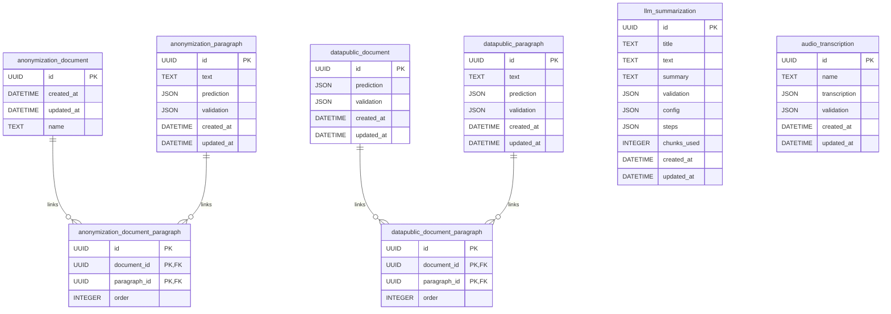

# Internal Database
Language: **English** | [Español](../es/database/README.md)

This document describes the internal persistence used by the API runtime.

## Engine and Migrations
- ORM: `SQLModel` (`sqlalchemy` backend)
- Migration tool: Alembic
- Runtime setting: `SQLALCHEMY_DATABASE_URI`
- Default DB URI: `sqlite:////resources/cache/sqlite/database.db`
- Startup behavior:
  1. API checks DB connectivity.
  2. If SQLite file does not exist, it creates parent directories.
  3. API runs `alembic upgrade head` on startup.

Related code:
- `aymurai/settings.py`
- `aymurai/api/startup/database.py`
- `aymurai/api/main.py`
- `aymurai/database/versions/13f78d08e925_create_database.py` (base schema)
- `aymurai/database/versions/49b3f24f7ad0_add_audio_transcription_table.py`
- `aymurai/database/versions/8f2c6a10b7d3_add_llm_summarization_table.py` (head)

## ER Diagram
Rendered inline so it can never drift out of sync with a stale image.
The same diagram lives standalone in [`schema.mmd`](schema.mmd).

## Tables

### `anonymization_document`
| Column | Type | Nullable | Notes |
|---|---|---|---|
| `id` | `UUID` | no | Primary key |
| `created_at` | `DATETIME` | no | Server default `CURRENT_TIMESTAMP` |
| `updated_at` | `DATETIME` | yes | Updated on row changes |
| `name` | `TEXT` | no | Original filename |

### `anonymization_paragraph`
| Column | Type | Nullable | Notes |
|---|---|---|---|
| `id` | `UUID` | no | Primary key, derived from paragraph text hash |
| `text` | `TEXT` | no | Normalized paragraph text |
| `prediction` | `JSON` | yes | Model predictions (`list[DocLabel]`) |
| `validation` | `JSON` | yes | Manual labels (`list[DocLabel]`) |
| `created_at` | `DATETIME` | no | Server default `CURRENT_TIMESTAMP` |
| `updated_at` | `DATETIME` | yes | Updated on row changes |

### `anonymization_document_paragraph`
| Column | Type | Nullable | Notes |
|---|---|---|---|
| `id` | `UUID` | no | Link row identifier |
| `document_id` | `UUID` | no | FK -> `anonymization_document.id` |
| `paragraph_id` | `UUID` | no | FK -> `anonymization_paragraph.id` |
| `order` | `INTEGER` | yes | Paragraph order in source document |

Primary key is composite over `id`, `document_id`, `paragraph_id`.

### `datapublic_document`
| Column | Type | Nullable | Notes |
|---|---|---|---|
| `id` | `UUID` | no | Primary key (document identifier) |
| `prediction` | `JSON` | yes | Reserved document-level prediction payload; not written by the current public router |
| `validation` | `JSON` | yes | Document-level validation payload |
| `created_at` | `DATETIME` | no | Server default `CURRENT_TIMESTAMP` |
| `updated_at` | `DATETIME` | yes | Updated on row changes |

### `datapublic_paragraph`
| Column | Type | Nullable | Notes |
|---|---|---|---|
| `id` | `UUID` | no | Primary key, derived from paragraph text hash |
| `text` | `TEXT` | no | Normalized paragraph text |
| `prediction` | `JSON` | yes | Model predictions (`list[DocLabel]`) |
| `validation` | `JSON` | yes | Reserved for paragraph-level validation; public route is currently commented legacy logic |
| `created_at` | `DATETIME` | no | Server default `CURRENT_TIMESTAMP` |
| `updated_at` | `DATETIME` | yes | Updated on row changes |

### `datapublic_document_paragraph`
| Column | Type | Nullable | Notes |
|---|---|---|---|
| `id` | `UUID` | no | Link row identifier |
| `document_id` | `UUID` | no | FK -> `datapublic_document.id` |
| `paragraph_id` | `UUID` | no | FK -> `datapublic_paragraph.id` |
| `order` | `INTEGER` | yes | Paragraph order in source document |

Primary key is composite over `id`, `document_id`, `paragraph_id`.

### `llm_summarization`
Written by the summarization flow. Standalone: it has no foreign keys to the
paragraph tables, because a summary is keyed by the whole source text.

| Column | Type | Nullable | Notes |
|---|---|---|---|
| `id` | `UUID` | no | Primary key, `text_to_uuid(text)` of the source document |
| `title` | `TEXT` | yes | Human-set title, written by the validation endpoint |
| `text` | `TEXT` | no | Source text that was summarized |
| `summary` | `TEXT` | no | Machine-generated summary (markdown) |
| `validation` | `JSON` | yes | Human-edited summary (TipTap `JSONContent`); `null` until validated |
| `config` | `JSON` | no | `SummarizationConfig` that produced the summary (`model`, `system_prompt`, `options`) |
| `steps` | `JSON` | no | Per-chunk `SummarizationStep` list (`chunk_index`, `input_tokens`, `source`) |
| `chunks_used` | `INTEGER` | no | Number of chunks the rolling summarization consumed |
| `created_at` | `DATETIME` | no | Server default `CURRENT_TIMESTAMP` |
| `updated_at` | `DATETIME` | yes | Updated on row changes |

`summary` and `validation` are deliberately **not** collapsed into one column:
they are different artifacts (markdown vs. editor document) and the client picks
which to render.

### `audio_transcription`
Written by the ASR flow. Also standalone, keyed by a hash of the audio bytes
rather than of any text.

| Column | Type | Nullable | Notes |
|---|---|---|---|
| `id` | `UUID` | no | Primary key, `data_to_uuid(audio_bytes)` |
| `name` | `TEXT` | no | Original filename, or the document id when absent |
| `transcription` | `JSON` | no | Machine transcription (`list[ASRParagraph]`) |
| `validation` | `JSON` | no | Human-corrected paragraphs (`list[ASRParagraph]`); empty list until validated |
| `created_at` | `DATETIME` | no | Server default `CURRENT_TIMESTAMP` |
| `updated_at` | `DATETIME` | yes | Updated on row changes |

Unlike `llm_summarization`, reads here **do** collapse: `ASRDocument.from_transcription`
returns `validation or transcription`, so a validated transcription shadows the
machine one.

## Endpoint to Persistence Mapping

### Anonymizer
- `POST /api/anonymizer/predict`
  - Reads `anonymization_paragraph` by paragraph UUID.
  - Writes `anonymization_paragraph.prediction` when cache is enabled.
- `POST /api/anonymizer/disambiguate`
  - Writes disambiguated predictions to `anonymization_paragraph.prediction`.
- `POST /api/anonymizer/validation`
  - Reads `anonymization_paragraph.validation`.
- `POST /api/anonymizer/anonymize-document`
  - Writes `anonymization_paragraph.validation`.
  - Creates `anonymization_document` keyed by uploaded file content hash.
  - Creates link rows in `anonymization_document_paragraph`.

### Data-public
- `POST /api/datapublic/predict/{document_id}`
  - Uses caller-provided `document_id` as the document primary key.
  - Ensures `datapublic_document` exists when `use_cache=true`.
  - Writes `datapublic_paragraph.prediction` when `use_cache=true`.
  - Writes link row in `datapublic_document_paragraph` when `use_cache=true`.
- `GET /api/datapublic/validation/document/{document_id}`
  - Reads `datapublic_document.validation`.
- `POST /api/datapublic/validation/document/{document_id}`
  - Upserts `datapublic_document.validation`.

### Summarization
- `POST /api/llm/summarize` and `POST /api/llm/summarize/stream`
  - Read `llm_summarization` by `text_to_uuid(text)` when `use_cache=true`.
  - On a miss, insert or replace the row; writing a fresh summary **clears** any
    stored `validation`.
  - A cache hit replays the stored row without calling the provider and leaves
    `validation` intact.
- `GET /api/llm/summarize/validation/document/{document_id}`
  - Reads the full row; `404` when absent.
- `POST /api/llm/summarize/validation/document/{document_id}`
  - Writes `validation` (and `title` when provided). Never touches `summary`.

### Transcription (ASR)
- `POST /api/asr/transcribe` and `POST /api/asr/transcribe/stream`
  - Read `audio_transcription` by `data_to_uuid(audio_bytes)` when `use_cache=true`.
  - On a miss, insert or replace the row with the machine `transcription`.
- `GET /api/asr/validation/document/{document_id}`
  - Reads the row; `404` when absent. Returns `validation` when non-empty,
    otherwise `transcription`.
- `POST /api/asr/validation/document/{document_id}`
  - Writes `validation` (and `name` when a `title` is provided).

## Legacy Note
Route modules for dataset CRUD (`/api/datapublic/dataset/*`) exist in code but are not mounted in the public router. Do not treat them as active public API until exposed in `core.router`.
