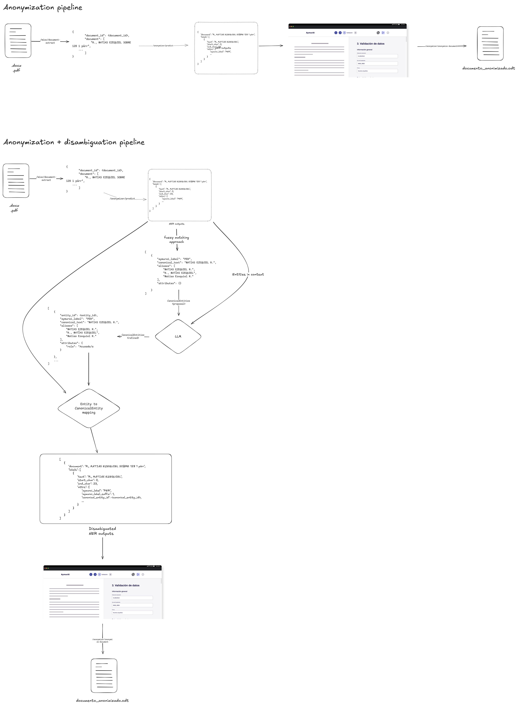

# Desambiguación de Entidades
Idioma: [English](../../anonymization/README.md) | **Español**

Notas de diseño y criterios de evaluación para la desambiguación de entidades
canónicas — el paso que decide qué spans de NER a lo largo de un documento se
refieren a la *misma* entidad real, para que la anonimización los reemplace de
forma consistente.

> **Leer esto como material de diseño, no como descripción de producción.** El
> diagrama incluye una etapa de refinamiento con LLM que es una **propuesta**; no
> está cableada en ningún pipeline. Lo que hoy corre es el camino de fuzzy
> matching descrito en [Qué está implementado](#qué-está-implementado).

## Contenidos
- Métrica de evaluación del desambiguador: [../../metrics/entity-disambiguation-metric.md](../../metrics/entity-disambiguation-metric.md)
- Diagrama del pipeline: `pipeline.png` (fuente editable: [`pipeline.excalidraw`](../../anonymization/pipeline.excalidraw))

## Flujo propuesto

La franja superior es el flujo de anonimización que ya existe. La inferior es la
extensión propuesta: las salidas del NER se agrupan por fuzzy matching en una
*propuesta* de `CanonicalEntities`, un LLM la refina usando el contexto
circundante (asignando `attributes.role`, uniendo o separando clusters), y el
conjunto refinado se mapea de vuelta sobre los spans antes de renderizar.

Regenerá el PNG con `node scripts/render-excalidraw.mjs` después de editar la
escena.

## Qué está implementado
La desambiguación de producción es solo fuzzy matching — no hay LLM en este camino:

- `aymurai/utils/entity_disambiguation/fuzzy.py` agrupa formas superficiales de
  alias con union-find sobre una matriz de distancias, elige una etiqueta de
  cluster y el alias más largo como `canonical_text`, y construye objetos
  `CanonicalEntity`.
- `aymurai/utils/entity_disambiguation/core.py` asigna los números
  `aymurai_label_instance` y mapea las entidades canónicas de vuelta sobre las
  predicciones del NER.
- `CanonicalEntity` (`aymurai/meta/entities.py`) lleva `entity_id`,
  `aymurai_label`, `canonical_text`, `aliases` y un dict libre `attributes`.
  Cuando falta `entity_id`, se deriva como UUID5 sobre los demás campos.
- El umbral de match es `THRESHOLD` (default `70`); el comportamiento por label
  viene de `DISAMBIGUATION_LABEL_POLICIES`. Ver la
  [referencia de configuración](../configuration/README.md#anonimización).

`attributes.role` aparece en todo el diagrama de diseño y en el documento de la
métrica, pero nada en el pipeline actual lo completa.

## Por qué una métrica propia
El desambiguador se evalúa aparte del modelo de NER, que se mide con F1 por clase.
Acertar los spans y acertar el *clustering* son problemas distintos: un NER
perfecto con un desambiguador malo igual filtra identidad a lo largo del
documento, porque la misma persona recibe reemplazos inconsistentes.

La métrica propuesta combina cuatro componentes — detección de entidades
canónicas, calidad del agrupamiento de aliases, exactitud de label y exactitud de
rol — en un único score ponderado. Ver
[el documento de la métrica](../../metrics/entity-disambiguation-metric.md).

## Documentos relacionados
- Flujo anonymizer: [../pipelines/anonymizer/README.md](../pipelines/anonymizer/README.md)
- Entidades de anonymizer: [../entities/anonymizer/README.md](../entities/anonymizer/README.md)
- Referencia de API: [../api/README.md](../api/README.md)
- Configuración: [../configuration/README.md](../configuration/README.md)
