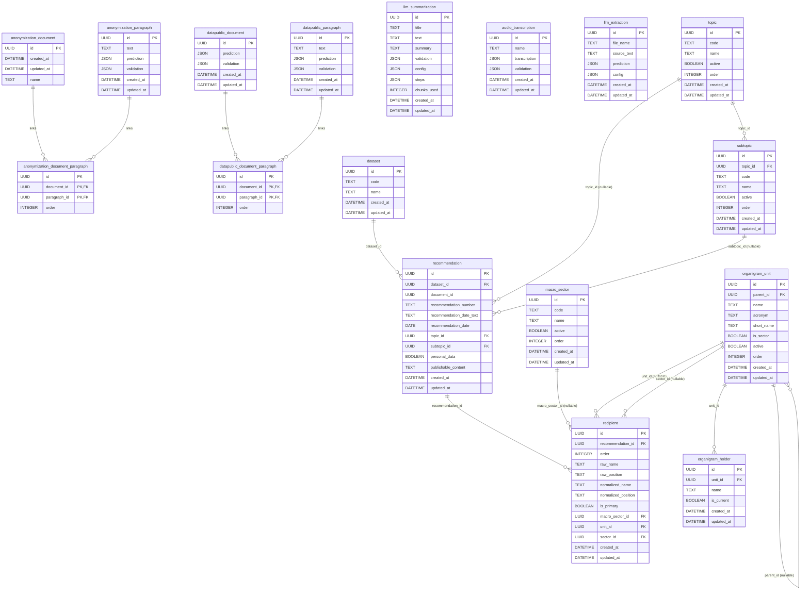

# Base de Datos Interna
Idioma: [English](../../database/README.md) | **Español**

Este documento describe la persistencia interna usada por la API en runtime.

## Motor y migraciones
- ORM: `SQLModel` (backend `sqlalchemy`)
- Herramienta de migración: Alembic
- Setting de runtime: `SQLALCHEMY_DATABASE_URI`
- URI por defecto: `sqlite:////resources/cache/sqlite/database.db`
- Comportamiento al iniciar:
  1. La API valida conectividad de DB.
  2. Si falta el archivo SQLite, crea los directorios padre.
  3. Ejecuta `alembic upgrade head` al iniciar.

Código relacionado:
- `aymurai/settings.py`
- `aymurai/api/startup/database.py`
- `aymurai/api/main.py`
- `aymurai/database/versions/13f78d08e925_create_database.py` (esquema base)
- `aymurai/database/versions/49b3f24f7ad0_add_audio_transcription_table.py`
- `aymurai/database/versions/8f2c6a10b7d3_add_llm_summarization_table.py`
- `aymurai/database/versions/dd89f40c7c3e_add_catalogs_tables.py`
- `aymurai/database/versions/ddf5877c18e3_add_organigram_tables.py`
- `aymurai/database/versions/fb3a0fa1490d_add_llm_extraction_table.py`
- `aymurai/database/versions/bd2987fdfc0e_add_dataset_recommendation_recipient_tables.py` (head)

Las últimas cuatro son la feature de la Defensoría del Pueblo (CABA) (ver
[más abajo](#defensoría-del-pueblo-caba)) y se aplican en ese orden — primero
`catalogs` y `organigram`, porque `recipient`/`recommendation` tienen foreign
keys hacia ellas. **Estas migraciones siempre corren**, independientemente del
feature flag `DEFENSORIA_ENABLED`, que solo gatea si se montan los routers
correspondientes.

## Operación

### Ubicación y persistencia del volumen
Dentro del contenedor la base vive en `/resources/cache/sqlite/database.db`;
en el host es `./resources/cache/sqlite/database.db`, accesible vía el bind
mount `./resources/cache:/resources/cache` en cada variante de la API
(`aymurai-api`, `aymurai-api-gpu`, `aymurai-api-full`, `aymurai-api-full-gpu`).
Ese mount tiene que seguir siendo un bind mount atado al host, no al
contenedor: si la base viviera solo en la capa escribible del contenedor,
recrear el contenedor (redeploy, `--force-recreate`, una actualización de
imagen) la borraría silenciosamente. Este fue un bug real en el perfil
`api-full`, corregido en esta Fase — a la definición de compose de ese
perfil directamente le faltaba el mount.

### Respaldos automáticos
El sidecar `db-backup` (`docker/backup/backup.py`) corre en loop, usando
`sqlite3.Connection.backup()` — seguro bajo WAL, a diferencia de copiar el
archivo con `cp`, que puede capturarlo a mitad de un checkpoint — y escribe
snapshots fechados `database_<timestamp>.db` en `./resources/backups`
(montado como `/backups` en el contenedor). Configuración, con los defaults
que quedaron en `docker-compose.yml`:
- `BACKUP_SOURCE_DB` — default `/resources/cache/sqlite/database.db`
- `BACKUP_INTERVAL_SECONDS` — default `3600` (como mucho un respaldo por hora)
- `BACKUP_RETENTION` — default `336`; conserva los N respaldos fechados más
  recientes y borra los demás. `BACKUP_RETENTION <= 0` desactiva la poda —
  **no** significa "borrar todo."

Una corrida cuya copia es idéntica byte a byte (sha256) al respaldo más
reciente se descarta en vez de escribirse (el sidecar loguea
`unchanged since …, skipped`), así que los respaldos solo se acumulan en las
horas en que la base efectivamente cambió. Con el intervalo horario por
default, los `336` respaldos conservados cubren:
- **al menos 14 días** aunque la base cambiara todas las horas, de día y de
  noche;
- **unas 7 semanas** a un ritmo realista — ediciones de la grilla solo en
  horario laboral (~9 horas con cambios por día, 5 días por semana ≈ 45
  respaldos por semana);
- todavía más a través de períodos sin actividad (feriados, fines de
  semana), que ya no consumen lugares.

El uso de disco es aproximadamente `BACKUP_RETENTION × tamaño de la base`:
una base de pocos MB (una base de desarrollo con un puñado de documentos y
transcripciones pesa ~4,5 MB) ocupa ~1,5 GB con la retención completa. Bajar
`BACKUP_RETENTION` si la base crece mucho más que eso, o subirlo para tener
más historia.

Para un respaldo manual e inmediato fuera del intervalo: `make db-backup`,
que corre el mismo script una sola vez (`--once`) y termina.

El loop en sí no arranca solo — hay que iniciarlo una vez con
`make db-backup-up`; de ahí en más `restart: always` lo mantiene corriendo
entre reinicios del host y del container (`make db-backup-stop` lo para,
`make db-backup-logs` sigue su output).

### Restaurar un respaldo
Parar la API antes de restaurar — `make db-restore` lo hace por sí solo,
parando cada variante de la API más `db-backup` y negándose a continuar si
alguna sigue reportada como corriendo. Después:
```
make db-restore BACKUP_FILE=database_<timestamp>.db
```
Como red de seguridad, si existe un `database.db` vivo cuando corre
`db-restore`, primero toma un snapshot automático invocando una vez el
sidecar `db-backup` (lo mismo que `make db-backup`) antes de tocar nada — el
estado previo a la restauración queda en `./resources/backups` como un
respaldo fechado más, no en un archivo aparte (o, si nada cambió desde el
último respaldo, el snapshot se saltea porque ese último respaldo ya tiene
exactamente los mismos bytes). Esto corre además de
cualquier verificación manual que hayas hecho antes, no en su lugar.

En un deploy nuevo, los directorios con bind mount (`resources/cache/`,
`resources/backups/`) pueden quedar con dueño root por Docker; las
operaciones sobre archivos del lado del host que hace `db-restore`
(los pasos `cp`/`mv`/`rm`) necesitan permiso para escribir ahí, así que puede
hacer falta ajustar el dueño de esos directorios o correr esos pasos con
privilegios suficientes antes de restaurar.

### Verificar un respaldo
Un respaldo no verificado no es un respaldo. Restaurarlo a un path temporal
— nunca sobre la base viva — y comprobar que tiene datos reales, por
ejemplo contando filas de una tabla conocida:
```
sqlite3 ./resources/backups/database_<timestamp>.db "SELECT COUNT(*) FROM recommendation;"
```
Un archivo SQLite estructuralmente válido y no vacío, con un conteo de filas
plausible, es lo que significa "verificado" acá; que el archivo exista no
alcanza.

### El workbook exportado no es un respaldo
El workbook que exporta la feature de la Defensoría del Pueblo es un reporte
de solo lectura generado a partir de la base; no se puede reimportar y no
sustituye a un respaldo de la base de datos. Ver
[ADR-0014](../../adr/0014-workbook-exportado-de-solo-lectura.md).

## Diagrama ER
Se renderiza inline para que no pueda quedar desfasado respecto de una imagen
vieja. El mismo diagrama vive suelto en [`schema.mmd`](../../database/schema.mmd).



## Tablas

### `anonymization_document`
| Columna | Tipo | Nulo | Notas |
|---|---|---|---|
| `id` | `UUID` | no | Primary key |
| `created_at` | `DATETIME` | no | Default server `CURRENT_TIMESTAMP` |
| `updated_at` | `DATETIME` | sí | Se actualiza ante cambios |
| `name` | `TEXT` | no | Nombre de archivo original |

### `anonymization_paragraph`
| Columna | Tipo | Nulo | Notas |
|---|---|---|---|
| `id` | `UUID` | no | Primary key, derivada del hash del texto |
| `text` | `TEXT` | no | Texto normalizado del párrafo |
| `prediction` | `JSON` | sí | Predicciones del modelo (`list[DocLabel]`) |
| `validation` | `JSON` | sí | Etiquetas validadas manualmente (`list[DocLabel]`) |
| `created_at` | `DATETIME` | no | Default server `CURRENT_TIMESTAMP` |
| `updated_at` | `DATETIME` | sí | Se actualiza ante cambios |

### `anonymization_document_paragraph`
| Columna | Tipo | Nulo | Notas |
|---|---|---|---|
| `id` | `UUID` | no | Identificador del vínculo |
| `document_id` | `UUID` | no | FK -> `anonymization_document.id` |
| `paragraph_id` | `UUID` | no | FK -> `anonymization_paragraph.id` |
| `order` | `INTEGER` | sí | Orden del párrafo en documento origen |

La clave primaria es compuesta por `id`, `document_id`, `paragraph_id`.

### `datapublic_document`
| Columna | Tipo | Nulo | Notas |
|---|---|---|---|
| `id` | `UUID` | no | Primary key (identificador del documento) |
| `prediction` | `JSON` | sí | Payload reservado de predicción a nivel documento; el router público actual no lo escribe |
| `validation` | `JSON` | sí | Payload de validación a nivel documento |
| `created_at` | `DATETIME` | no | Default server `CURRENT_TIMESTAMP` |
| `updated_at` | `DATETIME` | sí | Se actualiza ante cambios |

### `datapublic_paragraph`
| Columna | Tipo | Nulo | Notas |
|---|---|---|---|
| `id` | `UUID` | no | Primary key, derivada del hash del texto |
| `text` | `TEXT` | no | Texto normalizado del párrafo |
| `prediction` | `JSON` | sí | Predicciones del modelo (`list[DocLabel]`) |
| `validation` | `JSON` | sí | Reservado para validación por párrafo; la ruta pública hoy existe solo como lógica legacy comentada |
| `created_at` | `DATETIME` | no | Default server `CURRENT_TIMESTAMP` |
| `updated_at` | `DATETIME` | sí | Se actualiza ante cambios |

### `datapublic_document_paragraph`
| Columna | Tipo | Nulo | Notas |
|---|---|---|---|
| `id` | `UUID` | no | Identificador del vínculo |
| `document_id` | `UUID` | no | FK -> `datapublic_document.id` |
| `paragraph_id` | `UUID` | no | FK -> `datapublic_paragraph.id` |
| `order` | `INTEGER` | sí | Orden del párrafo en documento origen |

La clave primaria es compuesta por `id`, `document_id`, `paragraph_id`.

### `llm_summarization`
Escrita por el flujo de sumarización. Es autónoma: no tiene claves foráneas a las
tablas de párrafos, porque un resumen se indexa por el texto fuente completo.

| Columna | Tipo | Nulo | Notas |
|---|---|---|---|
| `id` | `UUID` | no | Clave primaria, `text_to_uuid(text)` del documento fuente |
| `title` | `TEXT` | sí | Título asignado por la persona, escrito por el endpoint de validación |
| `text` | `TEXT` | no | Texto fuente que se resumió |
| `summary` | `TEXT` | no | Resumen generado por el modelo (markdown) |
| `validation` | `JSON` | sí | Resumen editado por la persona (`JSONContent` de TipTap); `null` hasta validarse |
| `config` | `JSON` | no | `SummarizationConfig` que produjo el resumen (`model`, `system_prompt`, `options`) |
| `steps` | `JSON` | no | Lista de `SummarizationStep` por chunk (`chunk_index`, `input_tokens`, `source`) |
| `chunks_used` | `INTEGER` | no | Cantidad de chunks que consumió la sumarización rolling |
| `created_at` | `DATETIME` | no | Default del server `CURRENT_TIMESTAMP` |
| `updated_at` | `DATETIME` | sí | Se actualiza al modificar la fila |

`summary` y `validation` deliberadamente **no** se colapsan en una sola columna:
son artefactos distintos (markdown vs. documento de editor) y el cliente elige
cuál renderizar.

### `audio_transcription`
Escrita por el flujo de ASR. También autónoma, indexada por un hash de los bytes
del audio y no de un texto.

| Columna | Tipo | Nulo | Notas |
|---|---|---|---|
| `id` | `UUID` | no | Clave primaria, `data_to_uuid(audio_bytes)` |
| `name` | `TEXT` | no | Nombre de archivo original, o el id del documento si no hay |
| `transcription` | `JSON` | no | Transcripción del modelo (`list[ASRParagraph]`) |
| `validation` | `JSON` | no | Párrafos corregidos por la persona (`list[ASRParagraph]`); lista vacía hasta validarse |
| `created_at` | `DATETIME` | no | Default del server `CURRENT_TIMESTAMP` |
| `updated_at` | `DATETIME` | sí | Se actualiza al modificar la fila |

A diferencia de `llm_summarization`, acá las lecturas **sí** colapsan:
`ASRDocument.from_transcription` devuelve `validation or transcription`, así que
una transcripción validada tapa a la del modelo.

## Defensoría del Pueblo (CABA)
Nueve tablas respaldan la customización para la Defensoría del Pueblo (ver la
[referencia de pipeline](../pipelines/defensoria/README.md)). Sus routers se
montan solo cuando `DEFENSORIA_ENABLED=true`, pero **las tablas, migraciones
y datos de seed siempre existen**, sin importar el flag.

El enforcement de foreign keys de SQLite (`PRAGMA foreign_keys=ON`) se agregó
por conexión específicamente porque este esquema está cargado de FKs
(`aymurai/database/session.py`); aplica a toda la base, no solo a estas
tablas.

### `llm_extraction`
Cache autónomo de extracción cruda — sin foreign keys. Se indexa por un hash
de contenido provisto por el cliente, no por un id generado por la app.

| Columna | Tipo | Nulo | Notas |
|---|---|---|---|
| `id` | `UUID` | no | Primary key, **provisto por el cliente** (el `document_id` del request) |
| `file_name` | `TEXT` | sí | Nombre de archivo original, si se conoce |
| `source_text` | `TEXT` | no | Texto del documento sobre el que corrió la extracción |
| `prediction` | `JSON` | no | Salida cruda del LLM, tal cual |
| `config` | `JSON` | no | Config de generación (`model`, `options`, `catalogs_hash`) |
| `created_at` | `DATETIME` | no | Default server `CURRENT_TIMESTAMP` |
| `updated_at` | `DATETIME` | sí | Se actualiza ante cambios |

### `dataset`
| Columna | Tipo | Nulo | Notas |
|---|---|---|---|
| `id` | `UUID` | no | Primary key |
| `code` | `TEXT` | no | Único. Una única fila fija, `"defensoria-recommendations"`, creada de forma lazy; no hay endpoint de creación |
| `name` | `TEXT` | no | Etiqueta de display |
| `created_at` | `DATETIME` | no | Default server `CURRENT_TIMESTAMP` |
| `updated_at` | `DATETIME` | sí | Se actualiza ante cambios |

### `recommendation`
El registro a nivel documento validado por una persona — solo existe después
de `PUT /api/llm/data-extraction/{document_id}/validate`.

| Columna | Tipo | Nulo | Notas |
|---|---|---|---|
| `id` | `UUID` | no | Primary key |
| `dataset_id` | `UUID` | no | FK -> `dataset.id`, indexada |
| `document_id` | `UUID` | no | Indexada. **No es FK de base de datos** — se correlaciona por convención con `llm_extraction.id` (ambos son el hash de contenido provisto por el cliente), pero la integridad referencial entre ambos no está impuesta por la DB |
| `recommendation_number` | `TEXT` | sí | |
| `recommendation_date_text` | `TEXT` | sí | Fecha en prosa tal cual, del modelo o de una persona |
| `recommendation_date` | `DATE` | sí | Parseo normalizado de lo anterior; `null` cuando la prosa no parsea |
| `topic_id` | `UUID` | sí | FK -> `topic.id` |
| `subtopic_id` | `UUID` | sí | FK -> `subtopic.id` |
| `personal_data` | `BOOLEAN` | sí | Tri-estado: `NULL` significa que todavía no se respondió |
| `publishable_content` | `TEXT` | no | |
| `created_at` | `DATETIME` | no | Default server `CURRENT_TIMESTAMP` |
| `updated_at` | `DATETIME` | sí | Se actualiza ante cambios |

Constraint único: `(dataset_id, document_id)`.

### `recipient`
Una oficina/persona destinataria asociada a una `recommendation`.

| Columna | Tipo | Nulo | Notas |
|---|---|---|---|
| `id` | `UUID` | no | Primary key |
| `recommendation_id` | `UUID` | no | FK -> `recommendation.id`, indexada |
| `order` | `INTEGER` | no | Default `0` |
| `raw_name` | `TEXT` | sí | Nombre extraído/ingresado tal cual |
| `raw_position` | `TEXT` | sí | Cargo extraído/ingresado tal cual |
| `normalized_name` | `TEXT` | sí | Indexada; alimenta el índice aprendido del matching de organigrama |
| `normalized_position` | `TEXT` | sí | Indexada; alimenta el índice aprendido |
| `is_primary` | `BOOLEAN` | no | Default `False` |
| `macro_sector_id` | `UUID` | sí | FK -> `macro_sector.id` |
| `unit_id` | `UUID` | sí | FK -> `organigram_unit.id`; confirmado por una persona |
| `sector_id` | `UUID` | sí | FK -> `organigram_unit.id` (segundo vínculo a la misma tabla); confirmado por una persona **independientemente** de `unit_id`, denormalizado a propósito para que una reorganización posterior del organigrama no reescriba retroactivamente el historial |
| `created_at` | `DATETIME` | no | Default server `CURRENT_TIMESTAMP` |
| `updated_at` | `DATETIME` | sí | Se actualiza ante cambios |

Invariantes a nivel aplicación (no impuestas por la DB), chequeadas en
`recommendation_upsert`/`_reconcile_recipients`, no por un constraint o
trigger: `sector_id` siempre tiene que nombrar una unidad con
`is_sector=true`, y cuando `unit_id` y `sector_id` están ambos seteados,
`sector_id` tiene que ser un ancestro-o-sí-mismo `is_sector` de `unit_id`
(pertenencia, no identidad con lo que sugeriría automáticamente
`resolve_sector(unit_id)` — ese helper salta sectores desactivados, así que
no siempre es el más cercano). Todo el llamado de validación es una sola
transacción (ADR-0009): un destinatario rechazado también hace rollback de
los cambios propios de la fila `recommendation`.

### `topic` / `subtopic` / `macro_sector`
Los catálogos de clasificación que usan la extracción y la validación.

**`topic`**
| Columna | Tipo | Nulo | Notas |
|---|---|---|---|
| `id` | `UUID` | no | Primary key |
| `code` | `TEXT` | sí | Único; el código `area` original de la Defensoría, `null` para topics creados por la app |
| `name` | `TEXT` | no | |
| `active` | `BOOLEAN` | no | Default `True`; flag de soft-delete |
| `order` | `INTEGER` | no | Default `0`, orden de display |
| `created_at` / `updated_at` | `DATETIME` | no / sí | Estándar |

**`subtopic`**
| Columna | Tipo | Nulo | Notas |
|---|---|---|---|
| `id` | `UUID` | no | Primary key |
| `topic_id` | `UUID` | no | FK -> `topic.id` |
| `code` | `TEXT` | sí | Único (global, no por topic); el `codigo` de la Defensoría |
| `name` | `TEXT` | no | |
| `active` | `BOOLEAN` | no | Default `True` |
| `order` | `INTEGER` | no | Default `0` |
| `created_at` / `updated_at` | `DATETIME` | no / sí | Estándar |

Constraints únicos: `(code)`, `(topic_id, name)`.

**`macro_sector`**
| Columna | Tipo | Nulo | Notas |
|---|---|---|---|
| `id` | `UUID` | no | Primary key |
| `code` | `TEXT` | no | Único; uno de `GCBA`, `ORGANISMOS_NACIONALES`, `OBRA_SOCIAL_PREPAGA`, `EMPRESA`. Gobierna comportamiento — solo `GCBA` dispara el matching de organigrama — y nunca es editable vía API |
| `name` | `TEXT` | no | Etiqueta de display editable |
| `active` | `BOOLEAN` | no | Default `True` |
| `order` | `INTEGER` | no | Default `0` |
| `created_at` / `updated_at` | `DATETIME` | no / sí | Estándar |

Conjunto fijo y sembrado de 4 filas — la API puede
renombrar/reordenar/desactivar un macro-sector pero nunca crear o borrar uno.

### `organigram_unit` / `organigram_holder`
El organigrama institucional.

**`organigram_unit`**
| Columna | Tipo | Nulo | Notas |
|---|---|---|---|
| `id` | `UUID` | no | Primary key. Para filas sembradas, es un `uuid5` determinístico del path de la unidad, fijo para siempre una vez asignado (nunca se recalcula al renombrar); las unidades creadas vía la API reciben un `uuid4` aleatorio en cambio, porque no tienen un path del cual derivarlo |
| `parent_id` | `UUID` | sí | FK -> `organigram_unit.id` (árbol auto-referencial), indexada |
| `name` | `TEXT` | no | |
| `acronym` | `TEXT` | sí | p. ej. `AGIP` |
| `short_name` | `TEXT` | sí | Override curado para un puñado de organismos autónomos |
| `is_sector` | `BOOLEAN` | no | Default `False`; flag curado que marca "ancestro-o-sí-misma más profundo que cuenta como sector" |
| `active` | `BOOLEAN` | no | Default `True` |
| `order` | `INTEGER` | sí | Orden de display entre hermanos |
| `created_at` / `updated_at` | `DATETIME` | no / sí | Estándar |

**`organigram_holder`**
| Columna | Tipo | Nulo | Notas |
|---|---|---|---|
| `id` | `UUID` | no | Primary key |
| `unit_id` | `UUID` | no | FK -> `organigram_unit.id`, indexada |
| `name` | `TEXT` | no | Nombre del titular |
| `is_current` | `BOOLEAN` | no | Default `False`; curado, no "la última fila" |
| `created_at` / `updated_at` | `DATETIME` | no / sí | Estándar; el historial es append-only — asignar un nuevo titular actual siempre inserta una fila y pasa el anterior a `False`, nunca actualiza in place |

Índice único parcial sobre `(unit_id) WHERE is_current = 1` — como máximo un
titular actual por unidad, impuesto a nivel DB.

### Constraints y borrados
No hay `ON DELETE CASCADE` en ningún lado — toda foreign key es
`NO ACTION`/`RESTRICT` plana. Los "borrados" en `topic`, `subtopic`,
`macro_sector` y `organigram_unit` son todos soft (`active=false`); no hay
ruta de hard-delete para ninguna. Las filas de `recipient` que se caen
durante una re-validación, y los upserts de `llm_extraction`/`recommendation`,
son las únicas escrituras/borrados duros de esta feature.

### Sembrado
`aymurai/scripts/seed.py` (subcomandos `catalogs` y `organigram`) es un paso
**manual** de CLI — a diferencia de `alembic upgrade head`, no corre
automáticamente al iniciar la API. Ver la
[referencia de pipeline](../pipelines/defensoria/README.md#sembrado-del-organigrama-y-los-catálogos).

## Mapeo endpoint -> persistencia

### Anonymizer
- `POST /api/anonymizer/predict`
  - Lee `anonymization_paragraph` por UUID de párrafo.
  - Escribe `anonymization_paragraph.prediction` cuando el cache está activo.
- `POST /api/anonymizer/disambiguate`
  - Escribe predicciones desambiguadas en `anonymization_paragraph.prediction`.
- `POST /api/anonymizer/validation`
  - Lee `anonymization_paragraph.validation`.
- `POST /api/anonymizer/anonymize-document`
  - Escribe `anonymization_paragraph.validation`.
  - Crea `anonymization_document` con clave derivada del hash del contenido binario subido.
  - Crea vínculos en `anonymization_document_paragraph`.

### Data-public
- `POST /api/datapublic/predict/{document_id}`
  - Usa el `document_id` provisto por el cliente como primary key del documento.
  - Asegura existencia de `datapublic_document` cuando `use_cache=true`.
  - Escribe `datapublic_paragraph.prediction` cuando `use_cache=true`.
  - Escribe vínculo en `datapublic_document_paragraph` cuando `use_cache=true`.
- `GET /api/datapublic/validation/document/{document_id}`
  - Lee `datapublic_document.validation`.
- `POST /api/datapublic/validation/document/{document_id}`
  - Hace upsert de `datapublic_document.validation`.

### Sumarización
- `POST /api/llm/summarize` y `POST /api/llm/summarize/stream`
  - Leen `llm_summarization` por `text_to_uuid(text)` cuando `use_cache=true`.
  - Si no hay hit, insertan o reemplazan la fila; escribir un resumen nuevo
    **borra** cualquier `validation` almacenada.
  - Un hit de cache reproduce la fila almacenada sin llamar al proveedor y deja
    `validation` intacta.
- `GET /api/llm/summarize/validation/document/{document_id}`
  - Lee la fila completa; `404` si no existe.
- `POST /api/llm/summarize/validation/document/{document_id}`
  - Escribe `validation` (y `title` si se envía). Nunca toca `summary`.

### Transcripción (ASR)
- `POST /api/asr/transcribe` y `POST /api/asr/transcribe/stream`
  - Leen `audio_transcription` por `data_to_uuid(audio_bytes)` cuando `use_cache=true`.
  - Si no hay hit, insertan o reemplazan la fila con la `transcription` del modelo.
- `GET /api/asr/validation/document/{document_id}`
  - Lee la fila; `404` si no existe. Devuelve `validation` cuando no está vacía,
    y `transcription` en caso contrario.
- `POST /api/asr/validation/document/{document_id}`
  - Escribe `validation` (y `name` cuando se envía un `title`).

### Defensoría del Pueblo (CABA)
Gateado por `DEFENSORIA_ENABLED`; ver la
[referencia de pipeline](../pipelines/defensoria/README.md).

- `POST /api/llm/data-extraction`
  - Lee `llm_extraction` por `document_id` cuando `use_cache=true`.
  - Si no hay hit, inserta/reemplaza la fila de `llm_extraction` con la predicción cruda.
  - Lee `topic`, `subtopic`, `macro_sector` para armar la taxonomía viva del prompt.
  - Lee `organigram_unit`/`organigram_holder`/`recipient` (índice aprendido)
    para resolver el `unit_id`/`sector_id` sugerido de cada destinatario —
    nunca se persiste en este paso.
- `PUT /api/llm/data-extraction/{document_id}/validate`
  - Requiere una fila existente en `llm_extraction`; `404` si no.
  - Hace upsert de `recommendation` (único por `dataset_id` + `document_id`,
    creando de forma lazy la única fila de `dataset` en el primer uso).
  - Reconcilia filas de `recipient` (update-by-id / insert-if-new / delete-if-missing).
- `GET /api/llm/data-extraction/recommendations[/{recommendation_id}]`
  - Lee `recommendation` (+ `recipient`, `topic`, `subtopic`, `organigram_unit`
    asociados); `404` si un id específico no existe.
- `GET /api/llm/data-extraction/export`
  - Lee solo `recommendation` y `recipient` — nunca `llm_extraction`.
- `POST/GET/PATCH/DELETE /api/organigram/units[/{unit_id}]`, `.../holders[/{holder_id}]`
  - CRUD completo sobre `organigram_unit` y `organigram_holder`; los borrados
    son soft (`active=false`) para unidades, y asignar un titular inserta una
    nueva fila de `organigram_holder` en vez de actualizar in place.
- `POST/GET/PATCH/DELETE /api/catalogs/topics[/{topic_id}]`, `.../subtopics[/{subtopic_id}]`, `.../macro_sectors[/{macro_sector_id}]`
  - CRUD completo (macro-sectores: solo edición/desactivación) sobre `topic`,
    `subtopic`, `macro_sector`. `POST .../subtopics/{id}/reassign` repunta
    `recipient`/otras filas referenciantes a un `subtopic_id` distinto antes
    de un borrado.

## Nota legacy
Los módulos de rutas para CRUD de dataset (`/api/datapublic/dataset/*`) existen en código pero no están montados en el router público. No deben tratarse como API pública activa hasta su exposición en `core.router`.
