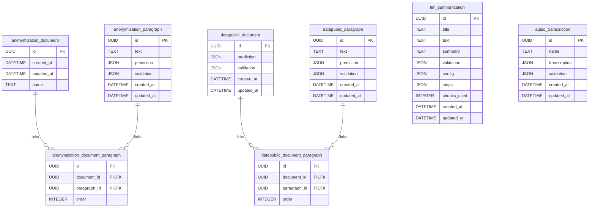

# Base de Datos Interna
Idioma: [English](../../database/README.md) | **Español**

Este documento describe la persistencia interna usada por la API en runtime.

## Motor y migraciones
- ORM: `SQLModel` (backend `sqlalchemy`)
- Herramienta de migración: Alembic
- Setting de runtime: `SQLALCHEMY_DATABASE_URI`
- URI por defecto: `sqlite:////resources/cache/sqlite/database.db`
- Comportamiento al iniciar:
  1. La API valida conectividad de DB.
  2. Si falta el archivo SQLite, crea los directorios padre.
  3. Ejecuta `alembic upgrade head` al iniciar.

Código relacionado:
- `aymurai/settings.py`
- `aymurai/api/startup/database.py`
- `aymurai/api/main.py`
- `aymurai/database/versions/13f78d08e925_create_database.py` (esquema base)
- `aymurai/database/versions/49b3f24f7ad0_add_audio_transcription_table.py`
- `aymurai/database/versions/8f2c6a10b7d3_add_llm_summarization_table.py` (head)

## Diagrama ER
Se renderiza inline para que no pueda quedar desfasado respecto de una imagen
vieja. El mismo diagrama vive suelto en [`schema.mmd`](../../database/schema.mmd).

## Tablas

### `anonymization_document`
| Columna | Tipo | Nulo | Notas |
|---|---|---|---|
| `id` | `UUID` | no | Primary key |
| `created_at` | `DATETIME` | no | Default server `CURRENT_TIMESTAMP` |
| `updated_at` | `DATETIME` | sí | Se actualiza ante cambios |
| `name` | `TEXT` | no | Nombre de archivo original |

### `anonymization_paragraph`
| Columna | Tipo | Nulo | Notas |
|---|---|---|---|
| `id` | `UUID` | no | Primary key, derivada del hash del texto |
| `text` | `TEXT` | no | Texto normalizado del párrafo |
| `prediction` | `JSON` | sí | Predicciones del modelo (`list[DocLabel]`) |
| `validation` | `JSON` | sí | Etiquetas validadas manualmente (`list[DocLabel]`) |
| `created_at` | `DATETIME` | no | Default server `CURRENT_TIMESTAMP` |
| `updated_at` | `DATETIME` | sí | Se actualiza ante cambios |

### `anonymization_document_paragraph`
| Columna | Tipo | Nulo | Notas |
|---|---|---|---|
| `id` | `UUID` | no | Identificador del vínculo |
| `document_id` | `UUID` | no | FK -> `anonymization_document.id` |
| `paragraph_id` | `UUID` | no | FK -> `anonymization_paragraph.id` |
| `order` | `INTEGER` | sí | Orden del párrafo en documento origen |

La clave primaria es compuesta por `id`, `document_id`, `paragraph_id`.

### `datapublic_document`
| Columna | Tipo | Nulo | Notas |
|---|---|---|---|
| `id` | `UUID` | no | Primary key (identificador del documento) |
| `prediction` | `JSON` | sí | Payload reservado de predicción a nivel documento; el router público actual no lo escribe |
| `validation` | `JSON` | sí | Payload de validación a nivel documento |
| `created_at` | `DATETIME` | no | Default server `CURRENT_TIMESTAMP` |
| `updated_at` | `DATETIME` | sí | Se actualiza ante cambios |

### `datapublic_paragraph`
| Columna | Tipo | Nulo | Notas |
|---|---|---|---|
| `id` | `UUID` | no | Primary key, derivada del hash del texto |
| `text` | `TEXT` | no | Texto normalizado del párrafo |
| `prediction` | `JSON` | sí | Predicciones del modelo (`list[DocLabel]`) |
| `validation` | `JSON` | sí | Reservado para validación por párrafo; la ruta pública hoy existe solo como lógica legacy comentada |
| `created_at` | `DATETIME` | no | Default server `CURRENT_TIMESTAMP` |
| `updated_at` | `DATETIME` | sí | Se actualiza ante cambios |

### `datapublic_document_paragraph`
| Columna | Tipo | Nulo | Notas |
|---|---|---|---|
| `id` | `UUID` | no | Identificador del vínculo |
| `document_id` | `UUID` | no | FK -> `datapublic_document.id` |
| `paragraph_id` | `UUID` | no | FK -> `datapublic_paragraph.id` |
| `order` | `INTEGER` | sí | Orden del párrafo en documento origen |

La clave primaria es compuesta por `id`, `document_id`, `paragraph_id`.

### `llm_summarization`
Escrita por el flujo de sumarización. Es autónoma: no tiene claves foráneas a las
tablas de párrafos, porque un resumen se indexa por el texto fuente completo.

| Columna | Tipo | Nulo | Notas |
|---|---|---|---|
| `id` | `UUID` | no | Clave primaria, `text_to_uuid(text)` del documento fuente |
| `title` | `TEXT` | sí | Título asignado por la persona, escrito por el endpoint de validación |
| `text` | `TEXT` | no | Texto fuente que se resumió |
| `summary` | `TEXT` | no | Resumen generado por el modelo (markdown) |
| `validation` | `JSON` | sí | Resumen editado por la persona (`JSONContent` de TipTap); `null` hasta validarse |
| `config` | `JSON` | no | `SummarizationConfig` que produjo el resumen (`model`, `system_prompt`, `options`) |
| `steps` | `JSON` | no | Lista de `SummarizationStep` por chunk (`chunk_index`, `input_tokens`, `source`) |
| `chunks_used` | `INTEGER` | no | Cantidad de chunks que consumió la sumarización rolling |
| `created_at` | `DATETIME` | no | Default del server `CURRENT_TIMESTAMP` |
| `updated_at` | `DATETIME` | sí | Se actualiza al modificar la fila |

`summary` y `validation` deliberadamente **no** se colapsan en una sola columna:
son artefactos distintos (markdown vs. documento de editor) y el cliente elige
cuál renderizar.

### `audio_transcription`
Escrita por el flujo de ASR. También autónoma, indexada por un hash de los bytes
del audio y no de un texto.

| Columna | Tipo | Nulo | Notas |
|---|---|---|---|
| `id` | `UUID` | no | Clave primaria, `data_to_uuid(audio_bytes)` |
| `name` | `TEXT` | no | Nombre de archivo original, o el id del documento si no hay |
| `transcription` | `JSON` | no | Transcripción del modelo (`list[ASRParagraph]`) |
| `validation` | `JSON` | no | Párrafos corregidos por la persona (`list[ASRParagraph]`); lista vacía hasta validarse |
| `created_at` | `DATETIME` | no | Default del server `CURRENT_TIMESTAMP` |
| `updated_at` | `DATETIME` | sí | Se actualiza al modificar la fila |

A diferencia de `llm_summarization`, acá las lecturas **sí** colapsan:
`ASRDocument.from_transcription` devuelve `validation or transcription`, así que
una transcripción validada tapa a la del modelo.

## Mapeo endpoint -> persistencia

### Anonymizer
- `POST /api/anonymizer/predict`
  - Lee `anonymization_paragraph` por UUID de párrafo.
  - Escribe `anonymization_paragraph.prediction` cuando el cache está activo.
- `POST /api/anonymizer/disambiguate`
  - Escribe predicciones desambiguadas en `anonymization_paragraph.prediction`.
- `POST /api/anonymizer/validation`
  - Lee `anonymization_paragraph.validation`.
- `POST /api/anonymizer/anonymize-document`
  - Escribe `anonymization_paragraph.validation`.
  - Crea `anonymization_document` con clave derivada del hash del contenido binario subido.
  - Crea vínculos en `anonymization_document_paragraph`.

### Data-public
- `POST /api/datapublic/predict/{document_id}`
  - Usa el `document_id` provisto por el cliente como primary key del documento.
  - Asegura existencia de `datapublic_document` cuando `use_cache=true`.
  - Escribe `datapublic_paragraph.prediction` cuando `use_cache=true`.
  - Escribe vínculo en `datapublic_document_paragraph` cuando `use_cache=true`.
- `GET /api/datapublic/validation/document/{document_id}`
  - Lee `datapublic_document.validation`.
- `POST /api/datapublic/validation/document/{document_id}`
  - Hace upsert de `datapublic_document.validation`.

### Sumarización
- `POST /api/llm/summarize` y `POST /api/llm/summarize/stream`
  - Leen `llm_summarization` por `text_to_uuid(text)` cuando `use_cache=true`.
  - Si no hay hit, insertan o reemplazan la fila; escribir un resumen nuevo
    **borra** cualquier `validation` almacenada.
  - Un hit de cache reproduce la fila almacenada sin llamar al proveedor y deja
    `validation` intacta.
- `GET /api/llm/summarize/validation/document/{document_id}`
  - Lee la fila completa; `404` si no existe.
- `POST /api/llm/summarize/validation/document/{document_id}`
  - Escribe `validation` (y `title` si se envía). Nunca toca `summary`.

### Transcripción (ASR)
- `POST /api/asr/transcribe` y `POST /api/asr/transcribe/stream`
  - Leen `audio_transcription` por `data_to_uuid(audio_bytes)` cuando `use_cache=true`.
  - Si no hay hit, insertan o reemplazan la fila con la `transcription` del modelo.
- `GET /api/asr/validation/document/{document_id}`
  - Lee la fila; `404` si no existe. Devuelve `validation` cuando no está vacía,
    y `transcription` en caso contrario.
- `POST /api/asr/validation/document/{document_id}`
  - Escribe `validation` (y `name` cuando se envía un `title`).

## Nota legacy
Los módulos de rutas para CRUD de dataset (`/api/datapublic/dataset/*`) existen en código pero no están montados en el router público. No deben tratarse como API pública activa hasta su exposición en `core.router`.
