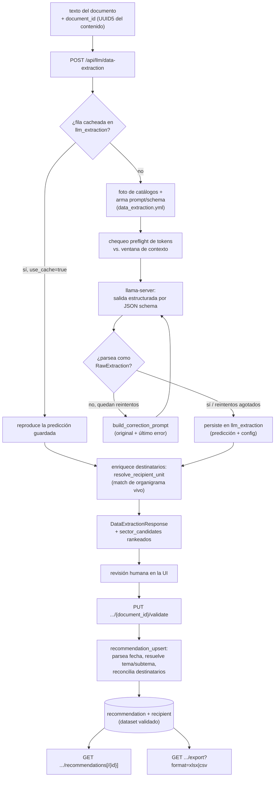
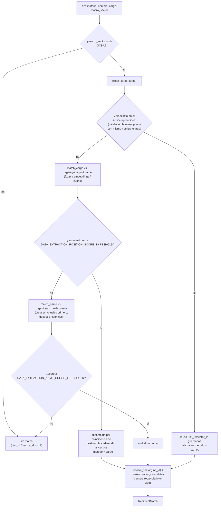

# Defensoría del Pueblo (CABA) — Flujo de Extracción de Datos
Idioma: [English](../../../pipelines/defensoria/README.md) | **Español**

Referencia técnica orientada al flujo de la customización para la Defensoría del
Pueblo de la Ciudad Autónoma de Buenos Aires: una extracción estructurada basada
en un LLM local que reemplaza el flujo NER genérico para este despliegue, cruza
los destinatarios extraídos contra un organigrama institucional, y persiste un
dataset de recomendaciones validado por una persona y exportable.

## Alcance
Este flujo lee un documento de recomendación judicial y extrae, vía un LLM
local, su número/fecha de recomendación, clasificación de tema/subtema, si
contiene datos personales, su contenido publicable, y uno o más destinatarios
(a quién va dirigida la recomendación). Cada destinatario se cruza
automáticamente contra un organigrama mantenido para sugerir la unidad/sector
de destino. Una persona valida y corrige la extracción después, produciendo un
registro `Recommendation` + `Recipient[]` que puede navegarse, filtrarse y
exportarse.

A diferencia de `anonymizer` y `datapublic`, este **no** es un pipeline de ML
de AymurAI — no tiene entrada bajo `resources/pipelines/production/`. Como
`summarization`, es una capa de orquestación sobre un `llama-server` externo,
más su propio CRUD de administración para el organigrama y los catálogos de
tema/subtema/macro-sector de los que depende.

## Feature flag
Todo el flujo — `/api/llm/data-extraction*`, `/api/organigram/*`,
`/api/catalogs/*` — se monta solo cuando `DEFENSORIA_ENABLED=true`
(`aymurai/settings.py`, default `False`). Con el flag apagado, ninguna de
estas rutas existe (`404` plano, no un error de configuración).

El flag gatea **solo el registro de routers**: las tablas, migraciones de
Alembic y scripts de seed subyacentes siempre corren, sin importar su valor.
Ver la [referencia de configuración](../../configuration/README.md#defensoría-del-pueblo-extracción-de-datos).

## Requisitos previos
`LLAMACPP_BASE_URL` tiene que apuntar a un `llama-server` corriendo — el mismo
setting de proveedor que usa `/api/llm/summarize`. Sin eso,
`POST /api/llm/data-extraction` responde `500 Configuration error`. Además, el
organigrama y los catálogos tienen que estar sembrados (ver
[Sembrado](#sembrado-del-organigrama-y-los-catálogos) más abajo) antes de que
el matching o la clasificación produzcan algo útil.

## Entradas de runtime
- `POST /api/llm/data-extraction` — corre (o reproduce cacheada) una extracción
- `PUT /api/llm/data-extraction/{document_id}/validate` — persiste correcciones humanas
- `GET /api/llm/data-extraction/recommendations` — listado paginado y filtrado
- `GET /api/llm/data-extraction/recommendations/{recommendation_id}` — detalle
- `GET /api/llm/data-extraction/export` — descarga todas las recomendaciones (`xlsx`/`csv`)
- `POST/GET/PATCH/DELETE /api/organigram/units[/{unit_id}]` — administración del árbol del organigrama (`GET` soporta `flat=true` para traer todo el árbol en un solo llamado)
- `GET/POST /api/organigram/units/{unit_id}/holders`, `PATCH /api/organigram/holders/{holder_id}` — administración del historial de titulares
- `POST/GET/PATCH/DELETE /api/catalogs/topics[/{topic_id}]`, `.../subtopics[/{subtopic_id}]` — administración de la taxonomía
- `GET/PATCH/DELETE /api/catalogs/macro_sectors[/{macro_sector_id}]` — lista fija de macro-sectores (solo edición de nombre/orden)

Contratos completos de request/response: [referencia de API](../../api/README.md#defensoría-del-pueblo-gateada-por-feature-flag).

## Flujo paso a paso
1. El cliente envía el texto del documento más un `document_id` que deriva
   determinísticamente del contenido (un `UUID5`, así que reenviar el mismo
   texto es un cache hit).
2. `POST /api/llm/data-extraction` primero busca en `llm_extraction` por ese
   id (`use_cache=true`, el default). Si no está, toma una foto de los
   catálogos vivos de tema/subtema/macro-sector, arma un system prompt y un
   JSON schema estricto desde `resources/llm/data_extraction.yml`, corre un
   chequeo de tokens preflight, y llama al LLM en modo de salida estructurada
   por JSON schema — reintentando con un prompt de corrección ante salida
   inválida.
3. La predicción cruda se persiste tal cual en `llm_extraction`. La respuesta
   HTTP se arma de cero a partir de eso, enriqueciendo cada destinatario con
   un match de organigrama **vivo** (nunca persistido en esta etapa) más una
   lista rankeada de sectores candidatos alternativos.
4. Una persona revisa la extracción en la UI, opcionalmente eligiendo un
   `unit_id`/`sector_id` distinto de entre los candidatos, corrigiendo
   tema/subtema, fechas, o el texto publicable.
5. `PUT /api/llm/data-extraction/{document_id}/validate` persiste la
   corrección como un `Recommendation` + `Recipient[]` — parseando la fecha en
   prosa, resolviendo las etiquetas de tema/subtema a ids, y reconciliando
   destinatarios (update/insert/delete por id, nunca delete-and-recreate). El
   llamado entero es una sola transacción (ADR-0009): si algún destinatario
   falla la validación, también se hace rollback de los campos de la
   `Recommendation`, no solo del destinatario con error.
6. Los registros validados son navegables (`GET .../recommendations[/{id}]`,
   con filtros por `topic_id`, `sector_id`, rango de fechas y texto libre) y
   descargables en bloque (`GET .../export`) como un `.xlsx` de dos hojas (o
   un `.csv` con solo la hoja de recomendaciones).

## Componentes técnicos

### Campos extraídos
El LLM extrae un conjunto fijo de campos por documento, definidos en
`resources/llm/data_extraction.yml` (`fields`) e impuestos por el JSON
schema armado para el llamado:

| Campo | Se extrae como | Notas |
|---|---|---|
| `recommendation_number` | `str \| null` | Suele figurar como pie de página ("Resolución Nro /\<AÑO\>") o en el nombre del archivo |
| `recommendation_date` | `str \| null` | Fecha en prosa, generalmente en el encabezado del documento |
| `recipients[].name` | `str \| null` | Nombre propio o denominación institucional — **nunca** un cargo/función |
| `recipients[].position` | `str \| null` | Cargo/función formal completo, con el organismo incluido cuando corresponda — **nunca** un nombre propio |
| `recipients[].is_primary` | `bool` | `true` cuando la medida (recomendación/exhortación/intimación) se dirige directamente a esa persona; `false` cuando solo recibe notificación/comunicación |
| `recipients[].macro_sector` | `str \| null` | Uno de `GCBA`, `Organismos Nacionales`, `Obra Social / Prepaga`, `Empresa`, o `null` |
| `topic` | `str \| null` | Una etiqueta de la taxonomía viva de temas |
| `subtopic` | `str \| null` | Una etiqueta de los subtemas del `topic` elegido |
| `personal_data` | `bool` | Si el documento contiene datos personales (nombres, DNI, direcciones, etc.) |
| `publishable_content` | `str` | Síntesis de 1-2 líneas; tiene que nombrar a quién se dirige la medida (`is_primary=true`), no debe presentar como destinatarios a quienes solo fueron notificados, y no debe incluir detalle que identifique a personas no públicas |

Dos reglas de extracción vale la pena conocer porque definen cómo se separan
`name`/`position`: cuando el documento nombra a una persona por su cargo
(*"el Presidente del Instituto de Vivienda, Sr. Juan Pérez"*), el modelo
genera **un solo** destinatario — `name` la persona, `position` el cargo
completo incluyendo el organismo — no un segundo destinatario para el
organismo. Un destinatario separado solo para el organismo se genera
únicamente cuando el documento lo menciona como parte propia y distinta
(p. ej. una línea de notificación aparte).

### Prompt y schema
- Fuente: `resources/llm/data_extraction.yml`.
- `build_system_prompt()` arma persona + guías + un bloque de "campos a
  extraer" + la lista **viva** de macro-sectores + la taxonomía **viva** de
  tema/subtema + un ejemplo de salida en JSON literal — todo en español.
  Nunca se le corre `.format()` después de armado (el ejemplo JSON está lleno
  de llaves literales).
- `build_response_schema()` arma un JSON Schema para el `response_format`
  nativo de OpenAI (`{"type": "json_schema", ...}`, no tool/function
  calling). Los campos nullable usan `anyOf`/enum-con-null en vez de
  `type: [..., "null"]`, porque el conversor GBNF de llama.cpp descarta esa
  combinación en silencio.

### Invocación del LLM
- Proveedor: `LlamaCppLLMProvider` (`aymurai/llm_providers/`), el mismo
  cliente compatible con OpenAI que usa la sumarización, hablando con
  `LLAMACPP_BASE_URL`.
- Sin streaming, de una sola pasada — el documento entero se envía en un solo
  llamado, sin chunking. `preflight()` renderiza el prompt exacto a través
  del propio chat template del server (`/apply-template`) y lo tokeniza
  (`/tokenize`) para chequear que entra en
  `min(n_ctx del server, LLM_MAX_CONTEXT_TOKENS)` antes de generar; si no,
  lanza `ContextTooSmallError` → HTTP `422`.
- Reintentos: hasta `DATA_EXTRACTION_MAX_RETRIES` (default `2`, o sea 3
  intentos en total) ante salida JSON/schema inválida, cada reintento armado
  desde el system prompt **original** más solo el último error y el texto
  crudo del intento que lo produjo (nunca encadena correcciones — el prompt
  enviado no crece entre intentos). Si se agotan los reintentos, el endpoint
  igual devuelve `200` (ADR-0005), nunca un 5xx: se reusa el último intento
  parseado con `topic`/`subtopic` forzados a `null` cuando repara limpio; si
  el último intento ni siquiera era un objeto JSON, la extracción entera cae
  a un esqueleto vacío (todos los campos `null`/vacíos) en su lugar.
- `max_tokens=DATA_EXTRACTION_MAX_TOKENS` (default `1024`), más
  `extra_body={"reasoning_effort": "none"}`.

### Matching de organigrama
Implementado en `aymurai/api/endpoints/routers/llm/organigram_matching.py`.
El matching solo corre cuando el `macro_sector.code` del destinatario es
`"GCBA"` — cualquier otro macro-sector (organismos nacionales, obras
sociales/prepagas, empresas) corta directo a "sin match".

- **Orden de resolución** (gana el primero que supera su umbral): índice
  aprendido → match de cargo/posición → match de nombre de titular → sin
  match.
- **Índice aprendido** (`recipient_learned_index_lookup`): una fila
  `Recipient` previamente confirmada por una persona con el mismo
  nombre/posición normalizados, y cuyo `unit_id` sigue activo. Se reusan sus
  `unit_id`/`sector_id` tal cual — una edición del organigrama después de
  validar no puede cambiar en silencio la respuesta histórica.
- **Backend de scoring** (`DATA_EXTRACTION_SEARCH_BACKEND`, default
  `hybrid`): `fuzzy` (`token_set_ratio` de RapidFuzz), `embeddings`
  (similitud coseno sobre un encoder de oraciones MiniLM, cacheado en disco y
  auto-invalidado cuando cambia el corpus del organigrama), o `hybrid` (peso
  `DATA_EXTRACTION_HYBRID_WEIGHT` sobre embeddings, default `0.25` — fuzzy
  domina por defecto).
- El **match de cargo** gana si su score máximo supera
  `DATA_EXTRACTION_POSITION_SCORE_THRESHOLD` (default `85`); los empates en
  el tope se desempatan según si el nombre de la cadena de ancestros de un
  candidato aparece literalmente en el texto de cargo crudo (distingue
  unidades con el mismo nombre en distintos ministerios).
- El **match de nombre** es evidencia más débil, descontada por
  `DATA_EXTRACTION_NAME_EVIDENCE_WEIGHT` (default `1.0`) antes de compararla
  contra `DATA_EXTRACTION_NAME_SCORE_THRESHOLD` (default `90`), y solo se
  intenta cuando falla el match de cargo.
- **`sector_candidates`** (top `DATA_EXTRACTION_TOP_K`, default `5`) siempre
  se recalcula de cero — toda unidad con buen score colapsa a su ancestro
  **activo** `is_sector=true` más cercano vía `resolve_sector` (un sector
  desactivado se salta, así que una sugerencia nunca propone uno) — sin
  importar qué paso resolvió el match. Esto habilita el "elegir otro" en la
  validación; es auto-resuelve-con-alternativas-rankeadas, no una única
  respuesta fija.

### Recommendation vs. recipient
- Una **recommendation** es el registro validado por una persona, a nivel
  documento (número, fecha, tema/subtema, flag de datos personales,
  contenido publicable). Solo existe después de `PUT .../validate` —
  distinto de, y derivado de una persona corrigiendo, la predicción cruda de
  `llm_extraction`.
- Un **recipient** es una oficina/persona destinataria asociada a una
  recommendation: `raw_name`/`raw_position` tal cual, más el `unit_id`
  confirmado por una persona y un `sector_id` confirmado
  **independientemente** (nunca re-derivado de `unit_id`, para que una
  reorganización posterior del organigrama no reescriba retroactivamente el
  historial). La capa de aplicación igual chequea consistencia al validar:
  `sector_id` siempre tiene que nombrar una unidad con `is_sector=true`, y
  cuando `unit_id` y `sector_id` están ambos seteados, `sector_id` tiene que
  ser un ancestro-o-sí-mismo `is_sector` de `unit_id` (`is_sector_ancestor_of`
  — *pertenencia*, no identidad con lo que `resolve_sector` sugeriría
  automáticamente, porque ese helper salta sectores desactivados y un sector
  desactivado después de que una persona lo confirmó no debe invalidar
  retroactivamente su fila). Cualquiera de las dos violaciones falla el
  request con `422`, y todo el llamado `PUT .../validate` es una sola
  transacción: un destinatario rechazado también hace rollback de los campos
  de la `Recommendation` (ADR-0009).

### Sembrado del organigrama y los catálogos
`aymurai/scripts/seed.py` (CLI de Typer) tiene dos subcomandos:
- `catalogs` — hace upsert de los 4 macro-sectores fijos y de la taxonomía de
  tema/subtema desde `defensoria_taxonomy.json`.
- `organigram` — recorre `organigram_GCBA.json`, construyendo el árbol de
  `organigram_unit` con ids determinísticos (`uuid5`) y nombrando los
  `organigram_holder` actuales; aplica heurísticas fijas para marcar
  `is_sector=true` (siglas de organismos autónomos, "Ministerio…",
  "Secretaría…" pero no "Subsecretaría…", etc.).

Ambos son idempotentes y **manuales** — no corren automáticamente al iniciar
la API (a diferencia de `alembic upgrade head`, que sí corre siempre).

### Export
`GET /api/llm/data-extraction/export?format=xlsx|csv` lee solo de las tablas
validadas (`recommendation`, `recipient`), nunca de `llm_extraction`. El
`.xlsx` tiene dos hojas (`recomendaciones`, `destinatarios`); el `.csv` tiene
solo la primera. Los booleanos tri-estado se renderizan `"si"`/`"no"`/`""`
(vacío = todavía no respondido). Las fechas se formatean en `EXPORT_TIMEZONE`
(default `America/Argentina/Buenos_Aires`) para evitar un salto de día UTC en
lo validado tarde a la noche (ART). El archivo se escribe en una ruta
temporal y se borra vía background task una vez enviada la respuesta — no
queda nada del lado del server más allá de las filas en la DB.

### Módulos de backend relevantes
- Routers: `aymurai/api/endpoints/routers/defensoria/{data_extraction,organigram,catalogs}.py`
- Schemas de request/response: `aymurai/api/endpoints/schemas/{requests,responses}/`
- Motor de extracción: `aymurai/api/endpoints/routers/llm/data_extraction_engine.py`
- Matching de organigrama: `aymurai/api/endpoints/routers/llm/organigram_matching.py`
- Export: `aymurai/api/endpoints/routers/llm/data_extraction_export.py`
- Normalización de texto: `aymurai/text/matching.py`
- Parseo de fechas: `aymurai/transforms/datetime_formatter/{core.py,patterns.py}`
- CRUD: `aymurai/database/crud/{llm_extraction,recommendation,recipient}.py`,
  `aymurai/database/crud/organigram/`, `aymurai/database/crud/catalogs/`
- Seeds: `aymurai/database/seed/{catalogs,organigram}.py`, `aymurai/scripts/seed.py`

## Persistencia (DB)
Tablas que toca este flujo:
- `llm_extraction` — cache de extracción cruda por documento
- `dataset`, `recommendation`, `recipient` — el dataset validado
- `topic`, `subtopic`, `macro_sector` — catálogos de clasificación
- `organigram_unit`, `organigram_holder` — el organigrama

Ver [la referencia de base de datos](../../database/README.md#defensoría-del-pueblo-caba).

## Notas
- Las tablas, migraciones y seeds corren sin importar `DEFENSORIA_ENABLED` —
  solo los routers están gateados.
- `recommendation.document_id` se correlaciona por convención con
  `llm_extraction.id` (ambos son el `UUID5` de contenido provisto por el
  cliente) pero **no** es una foreign key de base de datos.
- El enforcement de foreign keys de SQLite (`PRAGMA foreign_keys=ON`) se
  habilita por conexión específicamente por lo cargado de FKs que es este
  esquema (`aymurai/database/session.py`); aplica a toda la base, no solo a
  estas tablas.
- Las filas de `macro_sector` son fijas (sembradas, 4 filas: `GCBA`,
  `ORGANISMOS_NACIONALES`, `OBRA_SOCIAL_PREPAGA`, `EMPRESA`) — la API puede
  renombrar/reordenar/desactivar una pero nunca crear o borrar una.
- Los borrados en los endpoints de administración de esta feature son
  soft (`active=false`); nada se borra en duro salvo las filas de recipient
  que se caen durante una re-validación.

## Documentos relacionados
- Índice de pipelines: [../README.md](../README.md)
- Referencia de API: [../../api/README.md](../../api/README.md#defensoría-del-pueblo-gateada-por-feature-flag)
- Configuración: [../../configuration/README.md](../../configuration/README.md#defensoría-del-pueblo-extracción-de-datos)
- Base de datos interna: [../../database/README.md](../../database/README.md#defensoría-del-pueblo-caba)
- Registro de diseño (ADRs, análisis histórico): [../../../defensoria/README.md](../../../defensoria/README.md)
