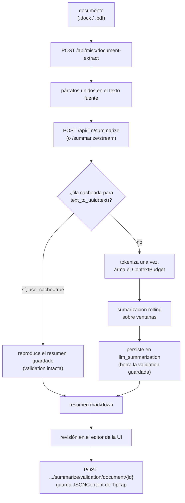

# Flujo de Sumarización
Idioma: [English](../../../pipelines/summarization/README.md) | **Español**

Referencia técnica orientada al flujo de sumarización de documentos con LLM.

## Alcance
Este flujo condensa un documento judicial en un resumen markdown estructurado y
lo persiste junto a una versión editable por una persona.

A diferencia de `anonymizer` y `datapublic`, **no** es un pipeline de ML de
AymurAI: no tiene entrada bajo `resources/pipelines/production/`. Es una capa de
orquestación sobre un `llama-server` externo que habla la API compatible con
OpenAI.

## Requisitos previos
`LLAMACPP_BASE_URL` tiene que apuntar a un `llama-server` corriendo. Sin eso,
todas las rutas de este flujo responden `500 Configuration error`. La imagen de
llama.cpp no incluye pesos — el GGUF lo provee quien despliega. Ver la
[referencia de configuración](../../configuration/README.md#sumarización-con-llm).

## Entradas de runtime
- `POST /api/misc/document-extract`
- `POST /api/llm/summarize` o `POST /api/llm/summarize/stream`
- `GET /api/llm/summarize/validation/document/{document_id}`
- `POST /api/llm/summarize/validation/document/{document_id}`

## Flujo paso a paso
1. La extracción de texto (`/api/misc/document-extract`) parte el documento en
   párrafos normalizados; el cliente los une en el texto a resumir.
2. La sumarización (`/api/llm/summarize`) chunkea el texto si hace falta, corre
   una sumarización rolling y guarda el resultado en `llm_summarization`.
3. La UI renderiza el resumen markdown en un editor.
4. La escritura de validación (`POST .../summarize/validation/document/{id}`)
   guarda el documento editado; la lectura devuelve ambas versiones juntas.

## Componentes técnicos

### Sumarización rolling
El motor tokeniza el documento una sola vez y después lo consume por ventanas:

- El `ContextBudget` se mide contra el `n_ctx` **del propio server**, con tope
  opcional de `LLM_MAX_CONTEXT_TOKENS`. El request no puede subirlo:
  `llama-server` fija la ventana al iniciar con `-c`.
- La primera ventana recibe `effective_ctx - scaffold_first - reserved_output`.
- Cada ventana posterior arrastra el resumen intermedio, y su presupuesto se
  calcula sobre el conteo de tokens **medido** del resumen y no sobre una reserva
  de peor caso — un resumen corto deja entonces más lugar para texto del documento.
- Las ventanas se recortan hacia atrás hasta un límite limpio dentro de una
  ventana de búsqueda acotada, para no cortar a mitad de palabra, y repiten
  `LLM_CHUNK_OVERLAP_TOKENS` tokens de contexto.
- Si el presupuesto de una ventana se reduce a cero, o si el prompt armado más la
  salida reservada exceden el contexto, la corrida falla con `422`.

Cada ventana aporta un `SummarizationStep` (`chunk_index`, `input_tokens`,
`source`), donde `source` es `chunk` en la primera ventana y `summary+chunk`
después.

### Prompts
- Fuente: `resources/llm/summarization.yml`
- `template` es el system prompt por defecto; `information_to_extract` y
  `entities_to_identify` completan sus placeholders.
- `rolling` es el system prompt de las ventanas siguientes.
- Un request puede reemplazar el system prompt entero con `system_prompt`, que
  tiene precedencia sobre las variables del template.

### Semántica de cache
La identidad de cache es **solo el texto fuente** (`text_to_uuid(text)`). La
config de generación almacenada nunca se compara contra el request, así que
cambiar `model`, `system_prompt` u `options` *no* dispara regeneración — para eso
hay que pasar `use_cache=false`. Regenerar borra la validación humana almacenada;
un hit de cache la deja intacta.

### Módulos de backend
- Rutas de generación: `aymurai/api/endpoints/routers/llm/summarization.py`
- Rutas de validación: `aymurai/api/endpoints/routers/llm/summary_validation.py`
- Motor (presupuesto, loop rolling, framing SSE): `aymurai/api/endpoints/routers/llm/summarization_engine.py`
- Ventaneo exacto en tokens: `aymurai/api/endpoints/routers/llm/chunking.py`
- Cliente del proveedor: `aymurai/llm_providers/`

## Persistencia (DB)
Tablas que toca este flujo:
- `llm_summarization`

Ver [la referencia de base de datos](../../database/README.md#llm_summarization).

## Notas
- `summary` (markdown) y `validation` (`JSONContent` de TipTap) se mantienen
  deliberadamente como columnas separadas y se devuelven ambas en la lectura; el
  cliente elige.
- Un resumen vacío significa que el modelo gastó todo su presupuesto de
  `max_tokens` en tokens de razonamiento. Subí `max_tokens`, o lanzá el server
  con `LLM_THINK_BUDGET=0`.
- `model` en el request es inerte en un `llama-server` de un solo modelo.

## Documentos relacionados
- Índice de pipelines: [../README.md](../README.md)
- Referencia de API: [../../api/README.md](../../api/README.md)
- Configuración: [../../configuration/README.md](../../configuration/README.md)
- Base de datos interna: [../../database/README.md](../../database/README.md)
