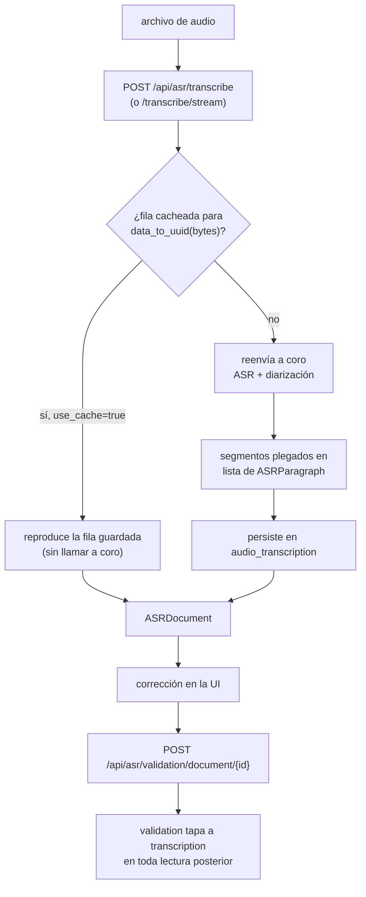

# Flujo de Transcripción (ASR)
Idioma: [English](../../../pipelines/transcription/README.md) | **Español**

Referencia técnica orientada al flujo de transcripción de voz a texto.

## Alcance
Este flujo convierte un archivo de audio en párrafos con hablante y marcas de
tiempo, y los persiste junto a una versión corregida por una persona.

Igual que [sumarización](../summarization/README.md), **no** es un pipeline de ML
de AymurAI: no tiene entrada bajo `resources/pipelines/production/`. AymurAI hace
de proxy sobre un server externo
[`coro`](https://github.com/collectiveai-team/coro) que resuelve ASR y
diarización detrás de una API de audio compatible con OpenAI.

## Requisitos previos
`TRANSCRIBE_BASE_URL` tiene que apuntar a un `coro` corriendo. Sin eso, todas las
rutas de este flujo responden `500 Configuration error`.

En compose, `coro` vive detrás del perfil `asr` y por lo tanto no arranca con un
`docker compose up` pelado:

```bash
make coro-up                        # CPU
CORO_SERVICE=coro-gpu make coro-up  # GPU
make coro-logs
```

Ver la [referencia de configuración](../../configuration/README.md#transcripción-asr)
para las variables de backend y modelo.

## Entradas de runtime
- `POST /api/asr/transcribe` o `POST /api/asr/transcribe/stream`
- `GET /api/asr/validation/document/{document_id}`
- `POST /api/asr/validation/document/{document_id}`

## Flujo paso a paso
1. La subida (`/api/asr/transcribe`) hashea los bytes del audio en un
   `document_id` y busca una fila cacheada en `audio_transcription`.
2. Si no hay hit, el request se reenvía a `coro`, y sus segmentos se pliegan en
   entradas `ASRParagraph` con número de hablante, inicio, fin y texto.
3. El resultado se guarda y se devuelve como `ASRDocument`.
4. La UI presenta la transcripción para corregir.
5. La escritura de validación guarda los párrafos corregidos; las lecturas
   posteriores los devuelven en lugar de la transcripción del modelo.



## Componentes técnicos

### Formas de datos
- `ASRParagraph` — `speaker_no`, `speaker_name` opcional, `start`, `end`, `text`,
  más un `paragraph_id` computado a partir del texto. `start` y `end` aceptan
  strings `HH:MM:SS` o segundos numéricos en la entrada.
- `ASRSpeakerTurn` — párrafos consecutivos de un mismo hablante, agrupados.
- `ASRDocument` — `document_id`, `title` opcional, la lista de párrafos y los
  turnos de habla.

### Colapso en la lectura
`ASRDocument.from_transcription` devuelve `validation or transcription`. Una vez
que una transcripción fue validada, los endpoints de lectura dejan de exponer la
versión del modelo — queda en la tabla, pero tapada. Esto difiere de la
sumarización, que devuelve ambos artefactos y deja elegir al cliente.

### Streaming y progreso
`/api/asr/transcribe/stream` emite frames SSE de tipo `meta`, `delta`, `segments`,
`done` y `error`. Ante un hit de cache emite `meta`, `segments`, `done` sin llamar
a `coro`.

El `progress` de los frames `delta` es una **estimación**, no un valor informado
por `coro`: suaviza `1 - exp(-k · raw)`, donde `raw` son los caracteres vistos
sobre `duración × ASR_PROGRESS_CHARS_PER_SEC`. Con `k = ln(10)` marca ~90% cuando
la estimación por caracteres cree que la transcripción terminó, y recién salta a
`1.0` en `done` en lugar de clavarse temprano. Si no se puede sondear la duración
del audio, `progress` se omite por completo.

### Módulos de backend
- Router: `aymurai/api/endpoints/routers/asr/transcribe.py`
- Esquemas de respuesta de `coro`: `aymurai/api/meta/asr/coro.py`
- Cliente, sondeo de duración y plegado de transcripción: `aymurai/audio/`
- Persistencia: `aymurai/database/crud/audio_transcription.py`

## Persistencia (DB)
Tablas que toca este flujo:
- `audio_transcription`

Ver [la referencia de base de datos](../../database/README.md#audio_transcription).

## Notas
- La identidad de cache es un hash de los bytes del audio, así que volver a subir
  el mismo archivo nunca vuelve a correr ASR, sin importar el nombre.
- El endpoint de validación acepta tanto un objeto `{title, document}` como una
  lista pelada de párrafos; esta última es una forma legacy que se mantiene para
  clientes viejos.
- Los párrafos transcritos son texto común y pueden alimentar el flujo de
  anonimización como cualquier otro contenido de documento.

## Documentos relacionados
- Índice de pipelines: [../README.md](../README.md)
- Referencia de API: [../../api/README.md](../../api/README.md)
- Configuración: [../../configuration/README.md](../../configuration/README.md)
- Base de datos interna: [../../database/README.md](../../database/README.md)
