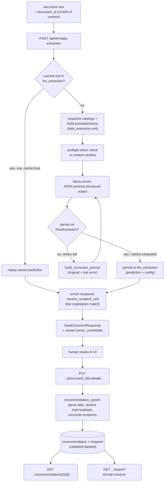
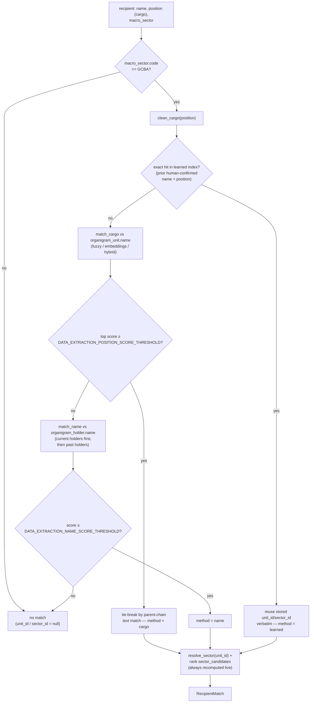

# Defensoría del Pueblo (CABA) — Data Extraction Flow
Language: **English** | [Español](../../es/pipelines/defensoria/README.md)

Workflow-oriented technical reference for the Defensoría del Pueblo (CABA)
customization: an LLM-based structured extraction that replaces the generic
NER flow for this deployment, cross-references extracted recipients against
an institutional org chart ("organigram"), and persists a human-validated,
exportable dataset of recommendations.

## Scope
This flow reads a judicial recommendation document and extracts, via a local
LLM, its recommendation number/date, topic/subtopic classification, whether
it carries personal data, its publishable content, and one or more
recipients (who the recommendation is addressed to). Each recipient is
automatically cross-referenced against a maintained organigram to suggest
the destination unit/sector. A human then validates and corrects the
extraction, producing a `Recommendation` + `Recipient[]` record that can be
browsed, filtered, and exported.

Unlike `anonymizer` and `datapublic`, this is **not** an AymurAI ML pipeline —
there is no entry under `resources/pipelines/production/`. Like
`summarization`, it is an orchestration layer over an external `llama-server`,
plus its own admin CRUD for the organigram and the topic/subtopic/macro-sector
catalogs it depends on.

## Feature flag
The whole flow — `/api/llm/data-extraction*`, `/api/organigram/*`,
`/api/catalogs/*` — is mounted only when `DEFENSORIA_ENABLED=true`
(`aymurai/settings.py`, default `False`). When the flag is off, none of these
routes exist (plain 404, not a configuration error).

The flag gates **router registration only**: the underlying tables, Alembic
migrations, and seed scripts always run regardless of its value. See the
[configuration reference](../../configuration/README.md#defensoría-del-pueblo-data-extraction).

## Prerequisites
`LLAMACPP_BASE_URL` must point at a running `llama-server` — the same
provider setting used by `/api/llm/summarize`. Without it,
`POST /api/llm/data-extraction` answers `500 Configuration error`. The
organigram and catalogs must additionally be seeded (see
[Seeding](#seeding-the-organigram-and-catalogs) below) before matching or
classification can produce anything useful.

## Runtime entrypoints
- `POST /api/llm/data-extraction` — run (or replay cached) extraction
- `PUT /api/llm/data-extraction/{document_id}/validate` — persist human corrections
- `GET /api/llm/data-extraction/recommendations` — paginated, filtered list
- `GET /api/llm/data-extraction/recommendations/{recommendation_id}` — detail
- `GET /api/llm/data-extraction/export` — download all recommendations (`xlsx`/`csv`)
- `POST/GET/PATCH/DELETE /api/organigram/units[/{unit_id}]` — org-chart tree admin (`GET` supports `flat=true` for the whole tree in one call)
- `GET/POST /api/organigram/units/{unit_id}/holders`, `PATCH /api/organigram/holders/{holder_id}` — holder history admin
- `POST/GET/PATCH/DELETE /api/catalogs/topics[/{topic_id}]`, `.../subtopics[/{subtopic_id}]` — taxonomy admin
- `GET/PATCH/DELETE /api/catalogs/macro_sectors[/{macro_sector_id}]` — fixed macro-sector list (name/order edit only)

Full request/response contracts: [API reference](../../api/README.md#defensoría-del-pueblo-feature-flagged).

## Step-by-step flow
1. The client sends the document text plus a `document_id` it derives
   deterministically from the content (a `UUID5`, so re-submitting the same
   text is a cache hit).
2. `POST /api/llm/data-extraction` checks `llm_extraction` for that id first
   (`use_cache=true`, the default). On a miss, it snapshots the live
   topic/subtopic/macro-sector catalogs, builds a system prompt and a strict
   JSON schema from `resources/llm/data_extraction.yml`, runs a preflight
   token check, and calls the LLM in JSON-schema structured-output mode —
   retrying with a correction prompt on invalid output.
3. The raw prediction is persisted verbatim to `llm_extraction`. The HTTP
   response is then built fresh from it, enriching every recipient with a
   **live** organigram match (never persisted at this stage) plus a ranked
   list of alternative sector candidates.
4. A human reviews the extraction in the UI, optionally picking a different
   `unit_id`/`sector_id` from the candidates, correcting topic/subtopic,
   dates, or the publishable text.
5. `PUT /api/llm/data-extraction/{document_id}/validate` persists the
   correction as a `Recommendation` + `Recipient[]` — parsing the prose date,
   resolving topic/subtopic labels to ids, and reconciling recipients
   (update/insert/delete by id, never delete-and-recreate). The whole call is
   one transaction (ADR-0009): if any recipient fails validation, the
   `Recommendation` fields are rolled back too, not just the bad recipient.
6. Validated records are browsable (`GET .../recommendations[/{id}]`, with
   `topic_id`, `sector_id`, date range, and free-text filters) and
   downloadable in bulk (`GET .../export`) as a two-sheet `.xlsx` (or a
   `.csv` with just the recommendations sheet).

## Technical components

### Extracted fields
The LLM extracts a fixed set of fields per document, defined in
`resources/llm/data_extraction.yml` (`fields`) and enforced by the JSON
schema built for the call:

| Field | Extracted as | Notes |
|---|---|---|
| `recommendation_number` | `str \| null` | Usually a footer legend ("Resolución Nro /\<AÑO\>") or the filename |
| `recommendation_date` | `str \| null` | Prose date, usually in the document header |
| `recipients[].name` | `str \| null` | A proper name or institution — **never** a role/position |
| `recipients[].position` | `str \| null` | The full formal role, institution included when explicit — **never** a proper name |
| `recipients[].is_primary` | `bool` | `true` when the measure (recommendation/exhortation/order) is addressed directly to them; `false` when they're only cc'd/notified |
| `recipients[].macro_sector` | `str \| null` | One of `GCBA`, `Organismos Nacionales`, `Obra Social / Prepaga`, `Empresa`, or `null` |
| `topic` | `str \| null` | One label from the live topic taxonomy |
| `subtopic` | `str \| null` | One label from the subtopics of the selected `topic` |
| `personal_data` | `bool` | Whether the document contains personal data (names, national ID, addresses, etc.) |
| `publishable_content` | `str` | A 1–2 line synthesis; must name who the measure targets (`is_primary=true`), must not name notify-only recipients as targets, and must omit identifying detail about non-public individuals |

Two extraction rules worth knowing because they shape how `name`/`position`
end up split: when a person is named by their role (*"el Presidente del
Instituto de Vivienda, Sr. Juan Pérez"*), the model emits **one** recipient —
`name` the person, `position` the full role including the institution — not
a second recipient for the institution itself. A separate institution-only
recipient is only emitted when the document actually addresses that
institution as its own distinct party (e.g. a separate cc line).

### Prompt and schema
- Source: `resources/llm/data_extraction.yml`.
- `build_system_prompt()` assembles persona + guidelines + a "fields to
  extract" block + the **live** macro-sector list + the **live**
  topic/subtopic taxonomy + a literal JSON output example — all in Spanish.
  It is never run through `.format()` after assembly (the JSON example is
  full of literal braces).
- `build_response_schema()` builds a JSON Schema for OpenAI-native
  `response_format={"type": "json_schema", ...}` (not tool/function
  calling). Nullable fields use `anyOf`/enum-with-null rather than
  `type: [..., "null"]`, because llama.cpp's GBNF grammar converter silently
  drops that combination.

### LLM invocation
- Provider: `LlamaCppLLMProvider` (`aymurai/llm_providers/`), the same
  OpenAI-compatible client used by summarization, talking to
  `LLAMACPP_BASE_URL`.
- Non-streaming, single-shot — the whole document is sent in one call, no
  chunking. `preflight()` renders the exact prompt through the server's own
  chat template (`/apply-template`) and tokenizes it (`/tokenize`) to check
  it fits `min(server n_ctx, LLM_MAX_CONTEXT_TOKENS)` before generating;
  otherwise it raises `ContextTooSmallError` → HTTP `422`.
- Retries: up to `DATA_EXTRACTION_MAX_RETRIES` (default `2`, so 3 attempts
  total) on invalid JSON/schema output, each retry built from the
  **original** system prompt plus only the latest error and the raw text of
  the attempt that produced it (never chaining corrections — the prompt sent
  never grows across attempts). If retries are exhausted, the endpoint still
  returns `200` (ADR-0005), never a 5xx: the last parsed attempt is reused
  with `topic`/`subtopic` forced to `null` when it repairs cleanly; if the
  last attempt wasn't even a JSON object, the whole extraction degrades to an
  empty skeleton (all fields `null`/empty) instead.
- `max_tokens=DATA_EXTRACTION_MAX_TOKENS` (default `1024`), plus
  `extra_body={"reasoning_effort": "none"}`.

### Organigram matching
Implemented in `aymurai/api/endpoints/routers/llm/organigram_matching.py`.
Matching only runs when the recipient's `macro_sector.code == "GCBA"` — every
other macro sector (national bodies, health insurers, companies) short-circuits
to no match.

- **Resolution order** (first to clear its threshold wins): learned index →
  cargo/position match → holder-name match → no match.
- **Learned index** (`recipient_learned_index_lookup`): a prior
  human-confirmed `Recipient` row with the same normalized name/position and
  whose `unit_id` is still active. Its `unit_id`/`sector_id` are reused
  verbatim — an organigram edit after validation can't silently change the
  historical answer.
- **Scoring backend** (`DATA_EXTRACTION_SEARCH_BACKEND`, default `hybrid`):
  `fuzzy` (RapidFuzz `token_set_ratio`), `embeddings` (cosine similarity over
  a MiniLM sentence encoder, disk-cached and auto-invalidated whenever the
  organigram corpus changes), or `hybrid` (`DATA_EXTRACTION_HYBRID_WEIGHT`
  weight on embeddings, default `0.25` — fuzzy-dominant by default).
- **Cargo match** wins if its top score clears
  `DATA_EXTRACTION_POSITION_SCORE_THRESHOLD` (default `85`); ties at the top
  are disambiguated by whether a candidate's ancestor-chain name literally
  appears in the raw position text (distinguishes identically-named units
  across different ministries).
- **Name match** is weaker evidence, discounted by
  `DATA_EXTRACTION_NAME_EVIDENCE_WEIGHT` (default `1.0`) before comparing
  against `DATA_EXTRACTION_NAME_SCORE_THRESHOLD` (default `90`), and only
  tried when cargo matching fails.
- **`sector_candidates`** (top `DATA_EXTRACTION_TOP_K`, default `5`) are
  always recomputed fresh — every well-scoring unit collapses to its nearest
  **active** `is_sector=true` ancestor via `resolve_sector` (a deactivated
  sector is walked past, so a suggestion never proposes one) — regardless of
  which step actually resolved the match. This powers the "pick a different
  one" affordance in validation; it is auto-resolve-with-ranked-alternatives,
  not a single fixed answer.

### Recommendation vs. recipient
- A **recommendation** is the human-validated, document-level record
  (number, date, topic/subtopic, personal-data flag, publishable content).
  It only exists after `PUT .../validate` — distinct from, and derived from
  a human correcting, the raw `llm_extraction` prediction.
- A **recipient** is a destination office/person attached to a
  recommendation: `raw_name`/`raw_position` verbatim, plus the
  human-confirmed `unit_id` and an **independently confirmed** `sector_id`
  (never re-derived from `unit_id`, so a later organigram reorg doesn't
  retroactively rewrite history). The application layer still checks
  consistency at validation time: `sector_id` must always name a unit with
  `is_sector=true`, and when both `unit_id` and `sector_id` are set,
  `sector_id` must be an `is_sector` ancestor-or-self of `unit_id`
  (`is_sector_ancestor_of` — *membership*, not identity with what
  `resolve_sector` would auto-suggest, since that helper skips deactivated
  sectors and a sector deactivated after a human confirmed it must not
  retroactively invalidate their row). Either violation fails the request
  with `422`, and the whole `PUT .../validate` call is one transaction: a
  rejected recipient rolls back the `Recommendation` fields too (ADR-0009).

### Seeding the organigram and catalogs
`aymurai/scripts/seed.py` (Typer CLI) has two subcommands:
- `catalogs` — upserts the 4 fixed macro sectors and the topic/subtopic
  taxonomy from `defensoria_taxonomy.json`.
- `organigram` — walks `organigram_GCBA.json`, building the `organigram_unit`
  tree with deterministic (`uuid5`) ids and appointing current
  `organigram_holder`s; applies fixed heuristics to flag `is_sector=true`
  (autonomous-body acronyms, "Ministerio…", "Secretaría…" but not
  "Subsecretaría…", etc.).

Both are idempotent and **manual** — not run automatically on API startup
(unlike `alembic upgrade head`, which always runs).

### Export
`GET /api/llm/data-extraction/export?format=xlsx|csv` reads only from
validated tables (`recommendation`, `recipient`), never `llm_extraction`. The
`.xlsx` has two sheets (`recomendaciones`, `destinatarios`); `.csv` has only
the first. Tri-state booleans render `"si"`/`"no"`/`""` (blank = not yet
answered). Timestamps are formatted in `EXPORT_TIMEZONE` (default
`America/Argentina/Buenos_Aires`) to avoid a UTC-day rollover for anything
validated late in the evening (ART). The file is written to a temp path and
removed via a background task once the response is sent — nothing is kept
server-side beyond the DB rows.

### Core backend modules
- Routers: `aymurai/api/endpoints/routers/defensoria/{data_extraction,organigram,catalogs}.py`
- Request/response schemas: `aymurai/api/endpoints/schemas/{requests,responses}/`
- Extraction engine: `aymurai/api/endpoints/routers/llm/data_extraction_engine.py`
- Organigram matching: `aymurai/api/endpoints/routers/llm/organigram_matching.py`
- Export: `aymurai/api/endpoints/routers/llm/data_extraction_export.py`
- Text normalization: `aymurai/text/matching.py`
- Date parsing: `aymurai/transforms/datetime_formatter/{core.py,patterns.py}`
- CRUD: `aymurai/database/crud/{llm_extraction,recommendation,recipient}.py`,
  `aymurai/database/crud/organigram/`, `aymurai/database/crud/catalogs/`
- Seeds: `aymurai/database/seed/{catalogs,organigram}.py`, `aymurai/scripts/seed.py`

## Persistence (DB)
Tables touched by this flow:
- `llm_extraction` — raw per-document extraction cache
- `dataset`, `recommendation`, `recipient` — the validated dataset
- `topic`, `subtopic`, `macro_sector` — classification catalogs
- `organigram_unit`, `organigram_holder` — the org chart

See [the database reference](../../database/README.md#defensoría-del-pueblo-caba).

## Notes
- Tables, migrations, and seeds run regardless of `DEFENSORIA_ENABLED` — only
  the routers are gated.
- `recommendation.document_id` correlates by convention with `llm_extraction.id`
  (both are the client-supplied content `UUID5`) but is **not** a database
  foreign key.
- SQLite foreign-key enforcement (`PRAGMA foreign_keys=ON`) is enabled
  per-connection specifically for this feature's FK-heavy schema
  (`aymurai/database/session.py`); it applies to the whole database, not just
  these tables.
- `macro_sector` rows are fixed (seeded, 4 rows: `GCBA`, `ORGANISMOS_NACIONALES`,
  `OBRA_SOCIAL_PREPAGA`, `EMPRESA`) — the API can rename/reorder/deactivate
  them but never create or delete one.
- Deletes across this feature's admin endpoints are soft (`active=false`);
  nothing is hard-deleted except recipient rows dropped during
  re-validation.

## Related docs
- Pipelines index: [../README.md](../README.md)
- API reference: [../../api/README.md](../../api/README.md#defensoría-del-pueblo-feature-flagged)
- Configuration: [../../configuration/README.md](../../configuration/README.md#defensoría-del-pueblo-data-extraction)
- Internal database: [../../database/README.md](../../database/README.md#defensoría-del-pueblo-caba)
- Design record (ADRs, historical analysis): [../../defensoria/README.md](../../defensoria/README.md)
