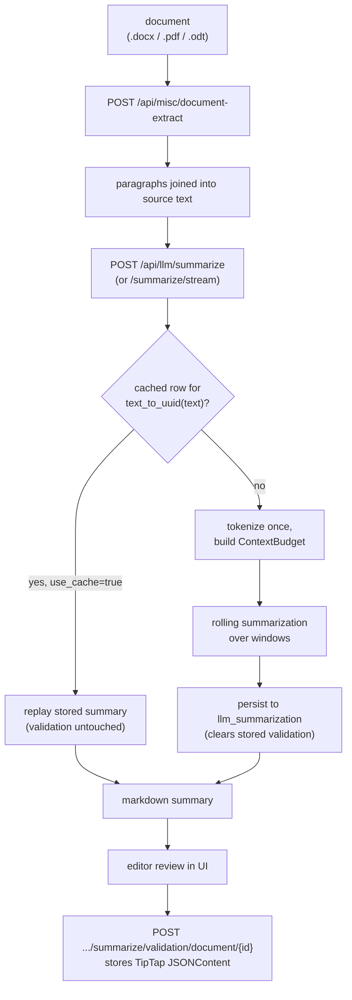

# Summarization Flow
Language: **English** | [Español](../../es/pipelines/summarization/README.md)

Workflow-oriented technical reference for LLM-backed document summarization.

## Scope
This flow condenses a judicial document into a structured markdown summary and
persists it alongside a human-editable version.

Unlike `anonymizer` and `datapublic`, it is **not** an AymurAI ML pipeline: there
is no entry under `resources/pipelines/production/`. It is an orchestration layer
over an external `llama-server` speaking the OpenAI-compatible API.

## Prerequisites
`LLAMACPP_BASE_URL` must point at a running `llama-server`. Without it every
route in this flow answers `500 Configuration error`. The llama.cpp image ships
no weights — you supply a GGUF. See the
[configuration reference](../../configuration/README.md#llm-summarization).

## Runtime entrypoints
- `POST /api/misc/document-extract`
- `POST /api/llm/summarize` or `POST /api/llm/summarize/stream`
- `GET /api/llm/summarize/validation/document/{document_id}`
- `POST /api/llm/summarize/validation/document/{document_id}`

## Step-by-step flow
1. Text extraction (`/api/misc/document-extract`) splits the source document into
   normalized paragraphs; the client joins them into the text to summarize.
2. Summarization (`/api/llm/summarize`) chunks the text if needed, runs a rolling
   summarization, and stores the result in `llm_summarization`.
3. The UI renders the markdown summary in an editor.
4. Validation write (`POST .../summarize/validation/document/{id}`) stores the
   edited document; validation read returns machine and human versions together.

## Technical components

### Rolling summarization
The engine tokenizes the document once, then consumes it in windows:

- `ContextBudget` is measured against the **server's own** `n_ctx`, optionally
  capped by `LLM_MAX_CONTEXT_TOKENS`. The request cannot raise it: `llama-server`
  fixes the window at launch with `-c`.
- The first window gets `effective_ctx - scaffold_first - reserved_output`.
- Every later window carries the interim summary forward, and its budget is
  computed from the summary's **measured** token count rather than a worst-case
  reservation — a short summary therefore leaves more room for document text.
- Windows snap backward to a clean boundary within a bounded lookback so they do
  not cut mid-word, and replay `LLM_CHUNK_OVERLAP_TOKENS` tokens of context.
- If a window's budget collapses to zero or the assembled prompt plus reserved
  output exceeds the context, the run fails with `422`.

Each window contributes a `SummarizationStep` (`chunk_index`, `input_tokens`,
`source`), where `source` is `chunk` for the first window and `summary+chunk`
afterwards.

### Prompts
- Source: `resources/llm/summarization.yml`
- `template` is the default system prompt; `information_to_extract` and
  `entities_to_identify` fill its placeholders.
- `rolling` is the system prompt for follow-up windows.
- A request may replace the whole system prompt with `system_prompt`, which takes
  precedence over the template variables.

### Caching semantics
Cache identity is the **source text alone** (`text_to_uuid(text)`). The stored
generation config is never compared against the request, so changing `model`,
`system_prompt` or `options` will *not* trigger regeneration — pass
`use_cache=false` for that. Regenerating clears any stored human validation; a
cache hit leaves it intact.

### Core backend modules
- Generation routes: `aymurai/api/endpoints/routers/llm/summarization.py`
- Validation routes: `aymurai/api/endpoints/routers/llm/summary_validation.py`
- Engine (budget, rolling loop, SSE framing): `aymurai/api/endpoints/routers/llm/summarization_engine.py`
- Token-exact windowing: `aymurai/api/endpoints/routers/llm/chunking.py`
- Provider client: `aymurai/llm_providers/`

## Persistence (DB)
Tables touched by this flow:
- `llm_summarization`

See [the database reference](../../database/README.md#llm_summarization).

## Notes
- `summary` (markdown) and `validation` (TipTap `JSONContent`) are deliberately
  kept as separate columns and both returned on read; the client picks.
- An empty summary means the model spent its whole `max_tokens` budget on
  reasoning tokens. Raise `max_tokens`, or launch the server with
  `LLM_THINK_BUDGET=0`.
- `model` in the request is inert on a single-model `llama-server`.

## Related docs
- Pipelines index: [../README.md](../README.md)
- API reference: [../../api/README.md](../../api/README.md)
- Configuration: [../../configuration/README.md](../../configuration/README.md)
- Internal database: [../../database/README.md](../../database/README.md)
