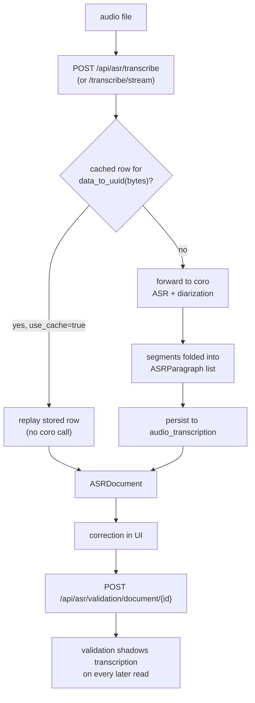

# Transcription Flow (ASR)
Language: **English** | [Español](../../es/pipelines/transcription/README.md)

Workflow-oriented technical reference for speech-to-text transcription.

## Scope
This flow turns an uploaded audio file into speaker-attributed, timestamped
paragraphs and persists them alongside a human-corrected version.

Like [summarization](../summarization/README.md), it is **not** an AymurAI ML
pipeline: there is no entry under `resources/pipelines/production/`. AymurAI
proxies an external [`coro`](https://github.com/collectiveai-team/coro) server
that performs ASR and diarization behind an OpenAI-compatible audio API.

## Prerequisites
`TRANSCRIBE_BASE_URL` must point at a running `coro`. Without it every route in
this flow answers `500 Configuration error`.

In compose, `coro` sits behind the `asr` profile and therefore does not start
with a plain `docker compose up`:

```bash
make coro-up                        # CPU
CORO_SERVICE=coro-gpu make coro-up  # GPU
make coro-logs
```

See the [configuration reference](../../configuration/README.md#asr-transcription)
for the backend and model variables.

## Runtime entrypoints
- `POST /api/asr/transcribe` or `POST /api/asr/transcribe/stream`
- `GET /api/asr/validation/document/{document_id}`
- `POST /api/asr/validation/document/{document_id}`

## Step-by-step flow
1. Upload (`/api/asr/transcribe`) hashes the audio bytes into a `document_id` and
   checks `audio_transcription` for a cached row.
2. On a miss, the request is forwarded to `coro`, whose segments are folded into
   `ASRParagraph` entries with speaker number, start, end and text.
3. The result is stored and returned as an `ASRDocument`.
4. The UI presents the transcript for correction.
5. Validation write stores the corrected paragraphs; subsequent reads return them
   in place of the machine transcription.



## Technical components

### Data shapes
- `ASRParagraph` — `speaker_no`, optional `speaker_name`, `start`, `end`, `text`,
  plus a computed `paragraph_id` derived from the text. `start` and `end` accept
  `HH:MM:SS` strings or numeric seconds on the way in.
- `ASRSpeakerTurn` — consecutive paragraphs from one speaker, grouped.
- `ASRDocument` — `document_id`, optional `title`, the paragraph list, and
  speaker turns.

### Read collapsing
`ASRDocument.from_transcription` returns `validation or transcription`. Once a
transcription has been validated, the machine version is no longer surfaced by
the read endpoints — it stays in the table but is shadowed. This differs from
summarization, which returns both artifacts and lets the client choose.

### Streaming and progress
`/api/asr/transcribe/stream` emits SSE frames typed `meta`, `delta`, `segments`,
`done` and `error`. On a cache hit it emits `meta`, `segments`, `done` without
calling `coro`.

`progress` on `delta` frames is an **estimate**, not a figure reported by `coro`:
it eases `1 - exp(-k · raw)` where `raw` is characters seen over
`duration × ASR_PROGRESS_CHARS_PER_SEC`. With `k = ln(10)` it reads ~90% when the
character estimate believes transcription is finished, then snaps to `1.0` on
`done` rather than pegging early. When the audio duration cannot be probed,
`progress` is omitted entirely.

### Core backend modules
- Router: `aymurai/api/endpoints/routers/asr/transcribe.py`
- `coro` response schemas: `aymurai/api/meta/asr/coro.py`
- Client, duration probing, transcript folding: `aymurai/audio/`
- Persistence: `aymurai/database/crud/audio_transcription.py`

## Persistence (DB)
Tables touched by this flow:
- `audio_transcription`

See [the database reference](../../database/README.md#audio_transcription).

## Notes
- Cache identity is a hash of the audio bytes, so re-uploading the same file
  never re-runs ASR regardless of filename.
- The validation endpoint accepts both a `{title, document}` object and a bare
  paragraph list; the latter is a legacy form kept for older clients.
- Transcribed paragraphs are ordinary text and can be fed into the anonymization
  flow like any other document content.

## Related docs
- Pipelines index: [../README.md](../README.md)
- API reference: [../../api/README.md](../../api/README.md)
- Configuration: [../../configuration/README.md](../../configuration/README.md)
- Internal database: [../../database/README.md](../../database/README.md)
